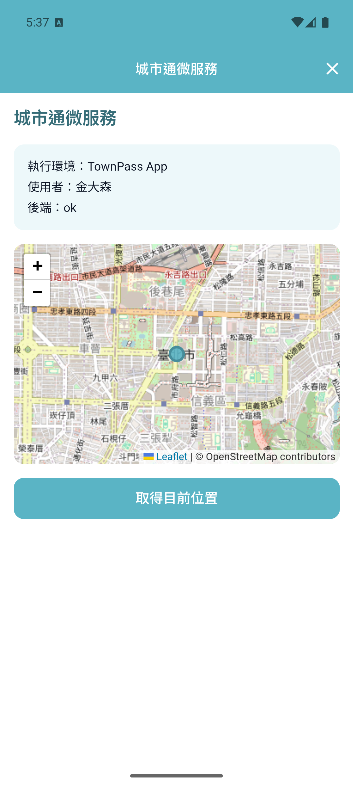

# 城市通微服務｜2026 臺北秋季程式設計節

> Fork 自 [taipei-doit/TownPass](https://github.com/taipei-doit/TownPass)。我們的作品是一個城市通微服務：在 App 的 WebView 中執行的網頁，加上後端 API。



| 資料夾 | 內容 |
|---|---|
| `lib/` `android/` `ios/` | TownPass Flutter App（上游程式碼，僅做最小修改） |
| `services/web/` | 微服務前端：Vue 3 + Vite + TypeScript + Tailwind + Leaflet/OSM |
| `services/backend/` | 後端：FastAPI（Python 3.12，uv） |
| `data/SOURCES.md` | 使用的開放資料與出處 |
| `docs/` | [團隊開發流程](docs/WORKFLOW.md)、[App ↔ 網頁訊息](docs/bridge.md) |
| `tools/` | 開發環境安裝與檢查腳本 |

## 快速開始

```bash
powershell -ExecutionPolicy Bypass -File tools/setup-windows.ps1   # 第一次：安裝 Flutter、Android SDK、pnpm、uv
powershell -ExecutionPolicy Bypass -File tools/doctor.ps1          # 檢查環境
```

每天的開發指令見 [docs/WORKFLOW.md](docs/WORKFLOW.md)。

## 授權 License

- 本隊於競賽期間開發之成果（`services/`、`data/`、`docs/`、`tools/` 及對 App 的修改）依競賽規則以 **GNU AGPL-3.0** 授權，全文見 [LICENSE-AGPL](LICENSE-AGPL)。
- 上游 TownPass 程式碼維持其原授權 GNU GPL-3.0，見 [LICENSE](LICENSE)。GPL-3.0 第 13 條允許與 AGPL-3.0 作品結合。

```
城市通微服務 — 2026 臺北秋季程式設計節參賽作品，以台北通為基礎之市政微服務。
Copyright (C) 2026 hackathon-taipei
This program is free software: you can redistribute it and/or modify it under the terms of the GNU Affero General Public License as published by the Free Software Foundation, either version 3 of the License, or (at your option) any later version.
This program is distributed in the hope that it will be useful, but WITHOUT ANY WARRANTY; without even the implied warranty of MERCHANTABILITY or FITNESS FOR A PARTICULAR PURPOSE. See the GNU Affero General Public License for more details.
You should have received a copy of the GNU Affero General Public License along with this program. If not, see https://www.gnu.org/licenses/.
```

---

# What is Town Pass?

Town Pass is an open-source project developed by the Taipei City Government. With the growth of smart cities, the demand for digitalization in city management and citizen services continues to rise. As we enter a new digital era, our goal is to involve citizens in the process, combining third-party expertise and innovation to make digital life in Taipei more convenient.

Town Pass is not just an application; it is an open community project. Through open-source, every citizen can participate in the ideation, development, and optimization of the application. This not only enhances citizen engagement and satisfaction but also leverages collective intelligence to continuously improve the application, making it truly serve the people. Furthermore, we hope that various municipalities can widely adopt the open-source framework of Town Pass, integrate it with their existing municipal service systems, and quickly have their own applications to enhance digital governance.

Open source is a key driver of technological progress and social development. Through open-source, Town Pass will become an ever-evolving platform, attracting developers from all backgrounds to contribute. We welcome experts to submit code, report issues, provide suggestions, and even develop new features and creative ideas, working together to perfect Town Pass as we advance toward a smart city.

# Getting Started

We highly recommend to read through our [document](https://tpe-guideline.web.app/en/docs/) for more detail.

Here are some quick setup guide.

## Requirement

- [Flutter](https://docs.flutter.dev/get-started/install) or [FVM](https://fvm.app/documentation/getting-started/installation)
- [XCode](https://developer.apple.com/xcode/) (for iOS)
- [Android SDK](https://developer.android.com/studio/index.html) (for Android, with or without Android Studio)

## Build the Project

1. Get the packages project needed:

   ``` bash
   flutter pub get
   ```

2. Generate additional needed dart code for the project.

   ``` bash
   dart run build_runner build
   ```

3. You are all set now, Run the project from your IDE or the through the command line:

   ``` bash
   flutter run
   ```
