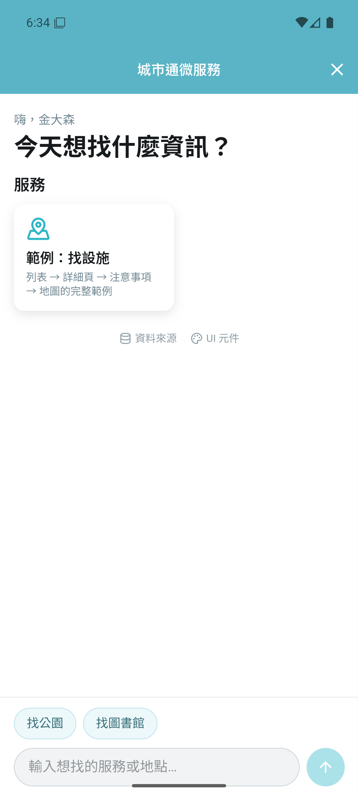
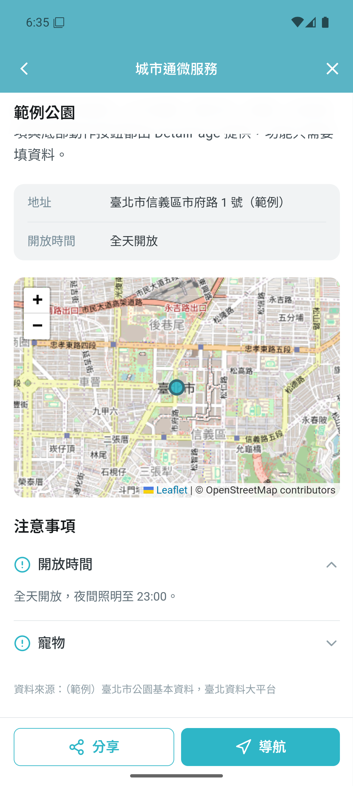

# UI 框架：用「疊加」的方式加功能

比賽當天每個人只在**自己的功能資料夾**裡新增檔案，不改共用檔案，功能就會接上首頁、對話框搜尋、近期使用與資料來源頁。

 

> 詳細規格與規則在 [system/](system/README.md)；給 AI 的工作流程在 `.claude/skills/`。

## 畫面結構
```
P01 首頁（對話框單一入口）
 ├─ O07 RecentStrip 近期使用          ← modules/recent
 ├─ O06 FeatureGrid 服務卡片          ← framework（自動列出 features/*）
 ├─ O05 ChatThread 對話、地圖、圖片、結果卡片 ← modules/assistant → modules/tools、modules/search（裝置端、離線、不用 LLM）
 └─ O04 ChatComposer 快捷 chips + 輸入框
      └─ 點卡片 → 功能頁（XX-P##）→ T02 DetailPage：摘要、M06 資訊列、O02 地圖、O03 注意事項、A07 資料來源
P02 資料來源頁    P03 UI 元件總覽 /#/dev/ui（開發模式）
```

## 新增前端功能
```bash
cp -r services/web/src/features/_template services/web/src/features/<id>
```
1. `index.ts`：`id`（= 資料夾名）、`code`（2–4 大寫字母，元件編號前綴）、`title`、`description`、`icon`
2. `data/`：呼叫後端（`api()`），失敗回傳 mock
3. `logic/`：`useXxx()` composable、`xxxSearchItems()`；私有工具函數用 `__` 開頭
4. `ui/`：頁面 `XX-P01…`、元件 `XX-C01…`，用 `@/ui` 的編號元件組合
5. `node tools/check-arch.mjs --catalog`

完整示範：[`services/web/src/features/example/`](../services/web/src/features/example/)（列表 → 詳細 → 注意事項 → 地圖，對話框標點與圖片）。

要在對話框顯示地圖、圖片，或用模型與登入：見 [加購件與對話框工具](system/09-addons.md)。

## 新增後端功能
```bash
cp -r services/backend/src/townpass_backend/features/_template services/backend/src/townpass_backend/features/<name>
```
`api.py`（HTTP）→ `service.py`（邏輯）→ `repo.py`（查詢）→ `models.py`（只放需要的欄位；缺的表／欄位啟動時自動補上）。
需要登入：啟用 auth 加購件後 `from townpass_backend.addons.auth import CurrentUser`（[說明](system/09-addons.md)）。
示範：[`features/examples/`](../services/backend/src/townpass_backend/features/examples/)。

## 各層文件
[顯示層](system/04-presentation-layer.md)・[邏輯層](system/05-logic-layer.md)・[資料層](system/06-data-layer.md)・[測試](system/07-testing.md)・[加購件](system/09-addons.md)・[元件目錄](system/components.md)
