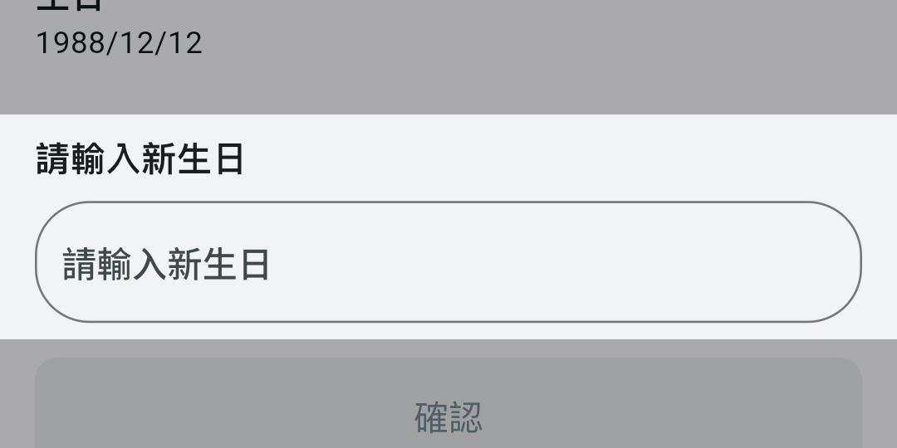
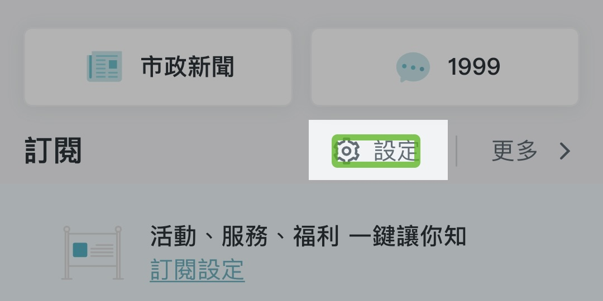
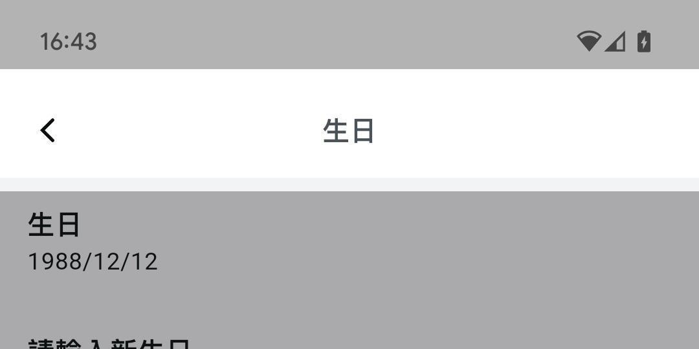
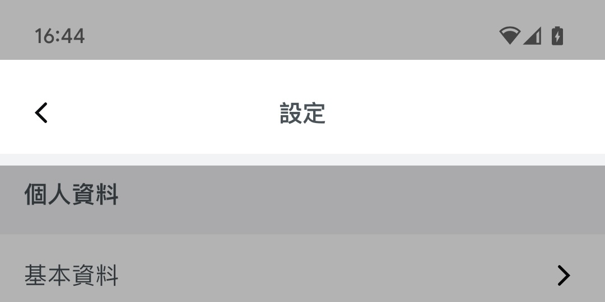

# 無障礙設計

## AT 替代文字與圖片

### [AT1 非文字內容的替代品](https://accessibility.moda.gov.tw/Download/Detail/1442?Category=62)

> 替代文字必須簡要描述圖片、物件或元件的編輯意圖或目的。

- 部分 icon 未設置可朗讀 label

### [AT2 裝飾性內容](https://accessibility.moda.gov.tw/Download/Detail/1443?Category=62)

> 裝飾性圖片必須從輔助技術中隱藏。

- 部分裝飾性 icon 於 iOS 仍會被朗讀出。

### [AT3 驗證碼或身份認證](https://accessibility.moda.gov.tw/Download/Detail/1444?Category=62)

> 驗證碼或身份認證應該依據行動裝置特性提供另一種驗證方式。

- Town Pass 未使用到驗證碼或身份認證功能。

### [AT4 視覺格式](https://accessibility.moda.gov.tw/Download/Detail/1445?Category=62)

> 不得單獨使用視覺格式來傳達含義。

- Town Pass 尚未對此處理。
  - 輸入欄位必填並未有視覺以外的提示。

## AV 時序媒體

### [AV1 視聽內容的替代品](https://accessibility.moda.gov.tw/Download/Detail/1449?Category=62)

> 時序媒體的替代內容（如字幕、手語、音訊描述）必須在可用的情況下，伴隨嵌入式媒體提供。

- Town Pass 未使用視聽內容。

### [AV2 不得自動播放音訊](https://accessibility.moda.gov.tw/Download/Detail/1450?Category=62)

> 除非使用者知道會產生音訊或事先知道該音訊可提供暫停/停止/靜音的按鈕，否則音訊不得自動播放。

- Town Pass 未有自動播放之音訊、影片內容。

## NT 通知

### [NT1 包容性通知](https://accessibility.moda.gov.tw/Download/Detail/1454?Category=62)

> 通知訊息必須同時可見和可聽。

- Town Pass 使用系統之通知模組，通知跳出時即會被朗讀。

### [NT2 錯誤訊息和更正](https://accessibility.moda.gov.tw/Download/Detail/1455?Category=62)

> 必須提供明確的錯誤訊息。

- Town Pass 尚未對表單之輸入顯示錯誤資訊或可朗讀之內容。

## TS 觸控操作

### [TS1 單點觸控](https://accessibility.moda.gov.tw/Download/Detail/1458?Category=62)

> 確認多點觸控或路徑觸控需有替代的單點觸控。

- Town Pass 為全面單點觸控之 UI。

### [TS2 觸發操作](https://accessibility.moda.gov.tw/Download/Detail/1459?Category=62)

> 觸發操作以向上事件為主，需有防止誤觸設計。  
>  物件、元件和控件在啟動開始時（當觸摸時）不會直接觸發動作/事件；當使用者完成啟動（觸摸已移開）時，物件、元件和控件將觸發操作/事件。

- Flutter UI 元件所提供的 `onTap()`, `onPressed()` 等等皆符合此規範。

### [TS3 觸控目標尺寸](https://accessibility.moda.gov.tw/Download/Detail/1460?Category=62)

> 觸控目標尺寸至少 48dp x 48dp (9mm x 9mm)。

- Town Pass 使用 Google Accessibility 進行檢驗，符合 TS3 之規範。

### [TS4 並行輸入機制](https://accessibility.moda.gov.tw/Download/Detail/1461?Category=62)

> 容許並行輸入機制的方式，如外接鍵盤或手寫筆等。

- Town Pass 容許多方輸入，未對觸控以外的輸入方式做阻擋。

## FC 焦點

### [FC1 可聚焦元件](https://accessibility.moda.gov.tw/Download/Detail/1462?Category=62)

> 所有互動元件必須是可聚焦的，非互動元件必須不能聚焦。

- 少部分非互動元件仍可聚焦
  - 設定頁面空白間隔可聚焦

### [FC2 鍵盤陷阱](https://accessibility.moda.gov.tw/Download/Detail/1463?Category=62)

> 簡述  
>  不得有鍵盤陷阱。  
>  物件、元件或控件可以使用標準導航方法進行瀏覽或離開。  
>  以可見的方式並透過螢幕報讀軟體離開項目導航的方法，該方法可將焦點穿過或跨過鍵盤陷阱。

- Town Pass 有避免使用鍵盤陷阱之 UI 元件。

### [FC3 焦點順序](https://accessibility.moda.gov.tw/Download/Detail/1464?Category=62)

> 簡述  
>  必須以有意義的順序瀏覽可操作的內容。  
>  焦點順序與頁面直觀視覺閱讀順序相同。  
>  當新增的項目出現或啟用，這些項目將出現在觸發他們的項目之後。

**[目前大多頁面於 Android 有符合]**

- 首頁下半部順序不符合「上至下，左至右」。

## FM 表單

### [FM1 標記表單控件](https://accessibility.moda.gov.tw/Download/Detail/1465?Category=62)

> 簡述  
>  必須標記所有表單控件。  
>  所有表單輸入欄位具有視覺的標籤。  
>  螢幕報讀軟體正確報讀所有表單輸入欄位標籤。

- 當前欄位 (更改使用者資訊頁面) 仍會先播報 label 後，下一動才會 focus 到輸入欄位。

### [FM3 分組表單元件](https://accessibility.moda.gov.tw/Download/Detail/1467?Category=62)

> 控件、標籤和其他表單元件必須正確配對。 邏輯分組一部分的螢幕上欄位具有可見分組名稱，指出為螢幕上欄位的標籤一部分。  
>  對於分組的每個欄位，螢幕報讀軟體報讀分組標籤優先於欄位標籤。

- Town Pass 未使用分組表單 UI。

### [FM4 管理焦點](https://accessibility.moda.gov.tw/Download/Detail/1468?Category=62)

> 在使用者輸入過程中，焦點或上下文不得自動更改。

- Town Pass 輸入表單皆不會於輸入過程中自動變更焦點。

### [FM5 表單佈局](https://accessibility.moda.gov.tw/Download/Detail/1469?Category=62)

> 標籤必須放置在靠近相關表單控件的位置，並適當佈置：
>
> - 在直向畫面中置於欄位的上方
> - 在橫向畫面中置於欄位的左側

- Town Pass 所使用之表單元件，其標籤皆位於表單左側或上側，並與其他表單有一定距離之間隔。

## LK 連結

### [LK1 描述式鏈結](https://accessibility.moda.gov.tw/Download/Detail/1471?Category=62)

> 鏈結和導航文字必須唯一地描述鏈結或項目的目標或功能。

- Town Pass 同一頁面上之可互動 UI 元件皆有其單一的輔助描述，不會與其他可互動 UI 混淆。

### [LK2合併重複的鏈結](https://accessibility.moda.gov.tw/Download/Detail/1472?Category=62)

> 必須將到同一組件的重複鏈結合併成單個鏈結。  
>  具有圖片和文字標籤的物件、元件和控件，僅宣告一次。  
>  具有圖片和文字標籤的物件、元件和控件的分組方式，僅使它們宣告為一個組件。

- Town Pass 所有同一組件之連結皆有做合併處理。

## DC 動態內容

### [DC1 禁止閃爍](https://accessibility.moda.gov.tw/Download/Detail/1474?Category=62)

> 動態內容不得明顯或有意地在任何一秒鐘中閃爍三遍。

- Town Pass 設計上有避免使用任何閃爍內容。

### [DC2 動態內容控制](https://accessibility.moda.gov.tw/Download/Detail/1475?Category=62)

> 當螢幕包含動態更新、移動、閃爍的滾動內容或動畫時，可以使用一種方法來停止、隱藏、暫停或控制內容。 該方法可讓輔助技術使用。

**[首頁跑馬燈輪播違反此項]**

### [DC3 懸浮內容](https://accessibility.moda.gov.tw/Download/Detail/1476?Category=62)

> 指標懸停時觸發的附加內容可由使用者移除或移動，指標可以在附加內容上移動，而且原內容不會消失。

- Town Pass 並未使用懸浮內容。

### [DC4 頁面更新](https://accessibility.moda.gov.tw/Download/Detail/1477?Category=62)

> 螢幕內容不會自動重整或改變，或者焦點在物件、元件或控件之間移動時，不會自動重整或改變。

**[首頁跑馬燈輪播違反此項]**

### [DC5 超時](https://accessibility.moda.gov.tw/Download/Detail/1478?Category=62)

> 時間限制的回應必須可調整。  
>  當表單或活動有時間限制時，使用者可關閉時間限制功能。  
>  使用者可以請求更多時間來完成表單/活動。  
>  使用者可以在超時前修改延長足夠的時間。

- Town Pass 並未使用時間限制之表單、跳窗。

## ST 結構

### [ST1 單一頁面標題](https://accessibility.moda.gov.tw/Download/Detail/1479?Category=62)

> 所有頁面或螢幕標題必須唯一且清晰可辨。

- Town Pass 頁面使用 Flutter 的 Scaffold 元件設置唯一 AppBar，標題置頂置中；可見下範例：

|  |  |
| --- | --- |
|  |  |

### [ST2 分組元件](https://accessibility.moda.gov.tw/Download/Detail/1480?Category=62)

> 可控元件，以分組進行呈現時，聚焦宣告須表示為同一整體結構，非單一控件。

- Town Pass 未使用分組控件。
