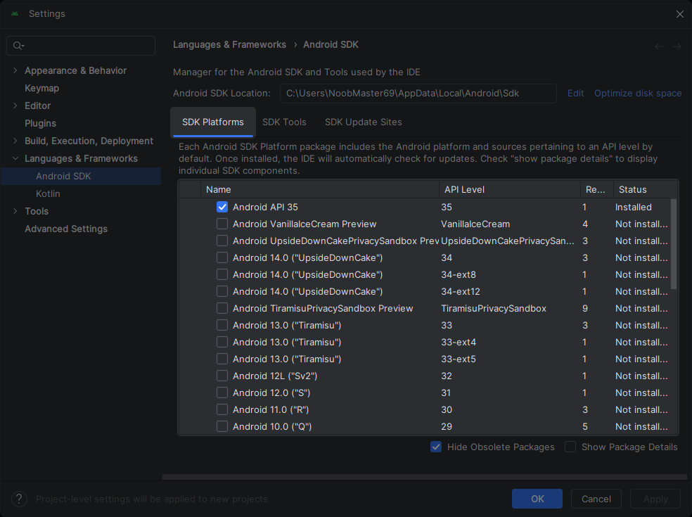
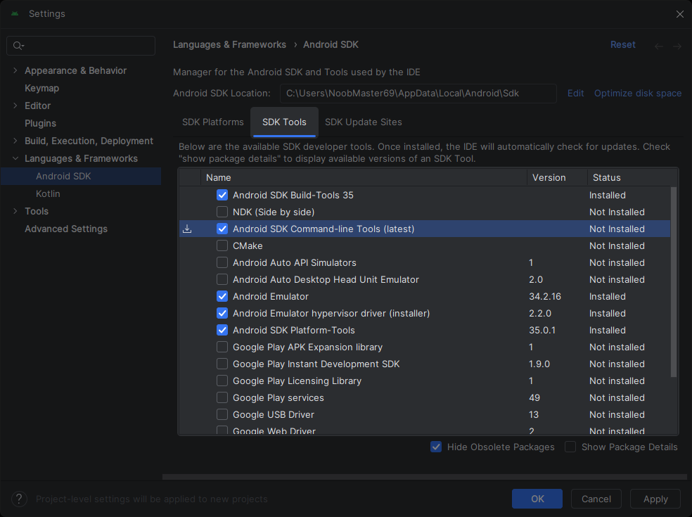

**Android Studio** 安裝完成後，確認以下組件皆已安裝：

- **Android SDK Platform, API 34.0.5 (Android 14.0 "UpsideDownCake") 或以上版本**
- **Android SDK Command-line Tools**
- **Android SDK Build-Tools**
- **Android SDK Platform-Tools**
- **Android Emulator**

1. 啟動 **Android Studio**。
2. 開啟 **SDK Manager**
3. 點擊 **SDK Platforms** 並檢查是否至少一個 **Android API 34.0.5 (Android 14.0 "UpsideDownCake") 或以上版本** 是勾選。
   ▼ 檢查是否有 Android SDK 皆有安裝

   
   若所有 **Status** 欄位顯示 **Update available** 或無任何一個以勾選項目：
   安裝完最新 SDK 後，**Status** 欄位可能會顯示 **Update available**。這通常是因為額外的系統映像檔尚未安裝。這不會影響後續的編譯工作，可忽略它並繼續接下來的流程。
   1. 勾選一個 **Android API** ( **34.0.5 (Android 14.0 "UpsideDownCake") 或以上版本** )。
   2. 點擊 **Apply**。
   3. 出現 **Confirm Change** 視窗時點擊 **OK**。
   4. 等待 **SDK Quickfix Installation** 安裝進度完成。
   5. 完成後點擊 **Finish**。
4. 點擊 **SDK Tool** 並檢查以下 SDK 工具是否已勾選
   ▼ 檢查 SDK Tools 是否都有安裝

   
   若有任何上述的 **Status** 欄位顯示 **Update available** 或 **Not installed**：
   - **Android SDK Command-line Tools**
   - **Android SDK Build-Tools**
   - **Android SDK Platform-Tools**
   - **Android Emulator**
   1. 勾選所需的 SDK 工具
   2. 點擊 **Apply**。
   3. 出現 **Confirm Change** 視窗時點擊 **OK**。
   4. 等待 **SDK Quickfix Installation** 安裝進度完成。
   5. 完成後點擊 **Finish**。
5. 設置完成。
