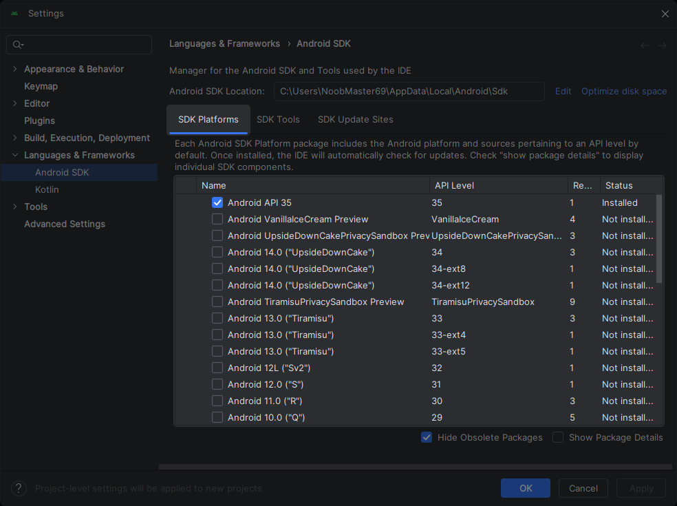
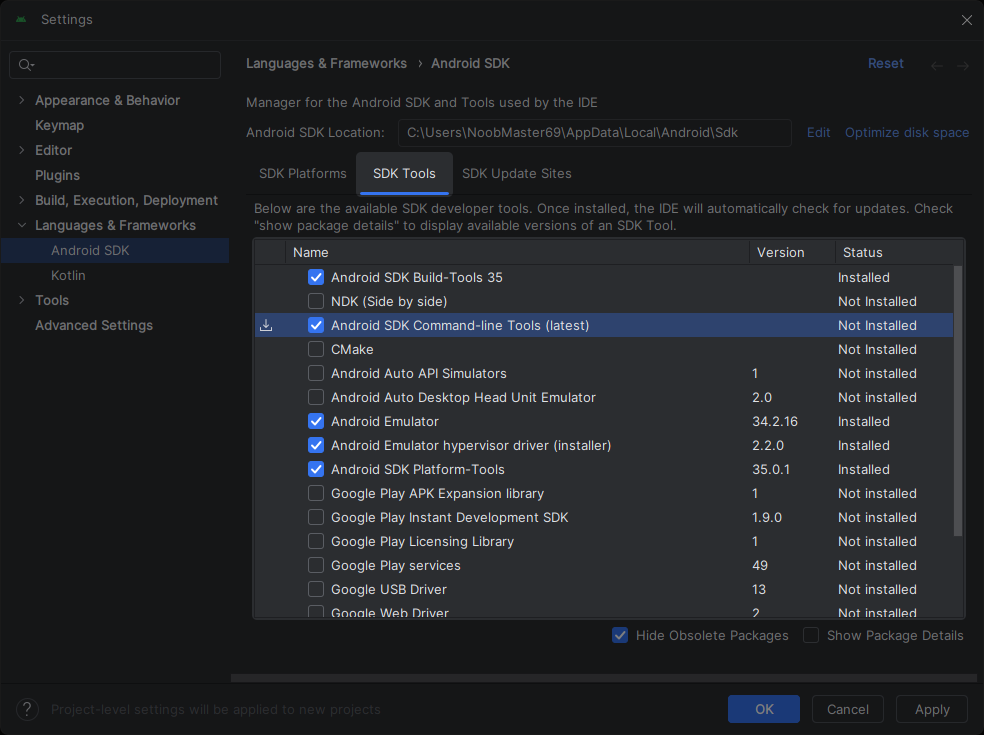

# 於 Windows 設置 Android 開發環境

## 系統需求

### 硬體需求

| 項目 | 建議需求 |
| --- | --- |
| CPU 核心數 | 8 |
| 記憶體 (GB) | 16 |
| 可用硬碟空間 (GB) | 60.0 |

### 軟體需求

提示

**Flutter SDK** 已包含其對應的 **Dart SDK**，你不需自行額外安裝 **Dart SDK**。

#### 作業系統

Flutter 支援 **64 位元 Windows 10 或更高版本**。這些版本的 Windows 會有內置的 **PowerShell 5 或更高版本**可供使用。

#### 開發工具

請先行下載安裝以下軟體：

- **[Git for Windows](https://gitforwindows.org) 2.27 或更高版本**，來管理程式碼。
- **[Android Studio](https://developer.android.com/studio) 2023.2.1 (Iguana) 或更高版本**，來除錯及編譯 Android 的 Java 或 Kotlin 程式碼。Flutter 需要完整版的 **Android Studio**。

#### 編輯器或整合開發環境 (IDE)

你可使用任意編輯器或整合開發環境 (IDE)，並结合 Flutter 的命令列工具進行建構；或使用帶有 Flutter 擴展或插件的 IDE，提供程式碼補全、語法突顯等等功能。

常見熱門 IDE 與對應之套件有：

- **[Visual Studio Code](https://code.visualstudio.com) 1.77 或更高版本**，搭配 [Flutter extension for VS Code](https://marketplace.visualstudio.com/items?itemName=Dart-Code.flutter)
- **[Android Studio](https://developer.android.com/studio) 2023.2.1 (Iguana) 或更高版本**，搭配 [Flutter plugin for IntelliJ](https://plugins.jetbrains.com/plugin/9212-flutter)
- **[IntelliJ IDEA](https://www.jetbrains.com/idea/download) 2023.2 或更高版本** (需付費，有試用版) 搭配 [Flutter plugin for IntelliJ](https://plugins.jetbrains.com/plugin/9212-flutter)

推薦

Flutter 團隊推薦安装 **Visual Studio Code**，搭配 **Flutter extension for VS Code**。這樣可以簡化並最快速的完成 **Flutter SDK** 安裝。

## 安裝 Flutter SDK

以下教學我們皆會將 **Flutter SDK** 放置在   (通常等同於  )。你可以自行選擇想要放置的位置。

注意

不要將 **Flutter SDK** 放置到以下目錄或路徑中：

- 路徑包含特殊字元或空格。
- 路徑需要較高權限。

例：  與   就屬於以上狀況。

## 設置 Android 開發環境

**Android Studio** 安裝完成後，確認以下組件皆已安裝：

- **Android SDK Platform, API 34.0.5 (Android 14.0 "UpsideDownCake") 或以上版本**
- **Android SDK Command-line Tools**
- **Android SDK Build-Tools**
- **Android SDK Platform-Tools**
- **Android Emulator**

1. 啟動 **Android Studio**。
2. 開啟 **SDK Manager**
3. 點擊 **SDK Platforms** 並檢查是否至少一個 **Android API 34.0.5 (Android 14.0 "UpsideDownCake") 或以上版本** 是勾選。
   ▼ 檢查是否有 Android SDK 皆有安裝

   
   若所有 **Status** 欄位顯示 **Update available** 或無任何一個以勾選項目：
   安裝完最新 SDK 後，**Status** 欄位可能會顯示 **Update available**。這通常是因為額外的系統映像檔尚未安裝。這不會影響後續的編譯工作，可忽略它並繼續接下來的流程。
   1. 勾選一個 **Android API** ( **34.0.5 (Android 14.0 "UpsideDownCake") 或以上版本** )。
   2. 點擊 **Apply**。
   3. 出現 **Confirm Change** 視窗時點擊 **OK**。
   4. 等待 **SDK Quickfix Installation** 安裝進度完成。
   5. 完成後點擊 **Finish**。
4. 點擊 **SDK Tool** 並檢查以下 SDK 工具是否已勾選
   ▼ 檢查 SDK Tools 是否都有安裝

   
   若有任何上述的 **Status** 欄位顯示 **Update available** 或 **Not installed**：
   - **Android SDK Command-line Tools**
   - **Android SDK Build-Tools**
   - **Android SDK Platform-Tools**
   - **Android Emulator**
   1. 勾選所需的 SDK 工具
   2. 點擊 **Apply**。
   3. 出現 **Confirm Change** 視窗時點擊 **OK**。
   4. 等待 **SDK Quickfix Installation** 安裝進度完成。
   5. 完成後點擊 **Finish**。
5. 設置完成。

## 設置 Android 裝置

注意

黑客松參與者請 **設置虛擬機** 進行成果展示。

## 檢查你的開發環境

### 執行 flutter doctor

執行 `flutter doctor` 指令來快速檢查你的電腦是否已設置好 Flutter 開發 Android app 的環境。

1. 打開 **PowerShell**。
2. 輸入以下指令：
   powershell

   ```
   flutter doctor
   ```
3. 若你是依據本文設置 Android app 開發環境，你的電腦並不一定會有   檢測的所有設置。你的輸出結果應當類似於：
   ```
   Running flutter doctor...
   Doctor summary (to see all details, run flutter doctor -v):
   [✓] Flutter (Channel stable, 3.24.0, on Microsoft Windows ...)
   [✓] Windows version (Installed version of Windows is version 10 or higher)
   [✓] Android toolchain - develop for Android devices (Android SDK version ...)
   [!] Chrome - develop for the web
   [!] Visual Studio - develop Windows apps
   [✓] Android Studio (version ...)
   [✓] VS Code (version ...)
   [✓] Connected device (1 available)
   [✓] Network resources


   ! Doctor found issues in 2 categories.
   ```
   其中 highlight 為必要條件：
   - ** **：編譯 Flutter。
   - ** **：環境 OS 需求。
   - ** **：編譯 Android app。
   - ** **：需有裝置 (模擬器) 執行 app 並進行成果展示。
   - ** **：編譯過程套件需網路資源下載、更新。

### 解決 flutter doctor 反應的問題

當   回報錯誤時，可能是 **Flutter**、**VS Code**、**Android Studio**、連接的設備或網路連線出錯。

你可使用   再次執行，獲得更多資訊或解決方式：

powershell

```
flutter doctor -v
```

查看輸出結果，了解可能需要安裝的其他軟體或需要執行的指令。

若你未來更改了 **Flutter SDK** 或其他組件的配置，請再次執行 `flutter doctor` 來進行檢查。

## 開始使用 Flutter 開發 Android on Windows 程式

**恭喜你！** 現在你已設置了所有必要條件與 **Flutter SDK**，你可以開始使用 Windows 開發 Android app、編譯 Flutter 程式了。
