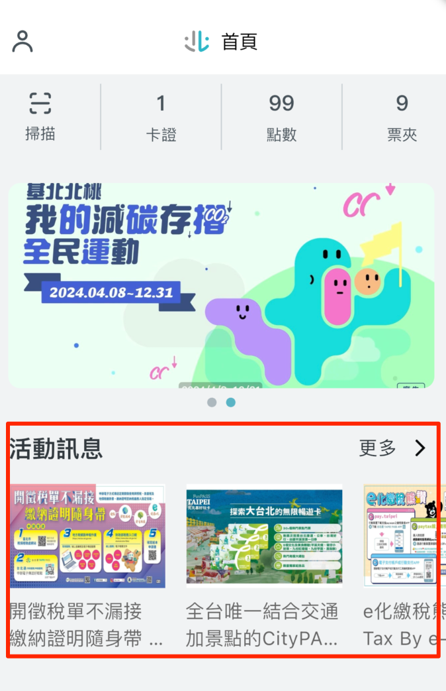
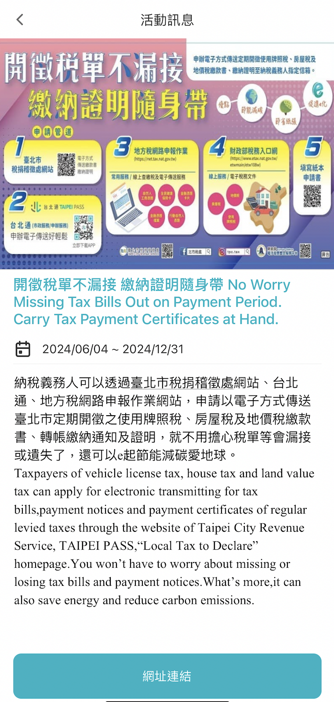

# 客製化設計

## 客製化區塊

首頁我們提供了兩大區塊給使用者透過 JSON 的方式去客製化自己心目中的內容，分別是：

- Banner 輪播
- 活動消息列表

### Banner 輪播


banner 輪播上每張圖片都是一個連結，點擊後會將使用者導向 webview 開啟指定的網頁 url，可以透過 JSON 來定義 banner 的圖片以及導向 webview 後需要開啟的 url。

完整 JSON 格式如下

json

```
{
  "data": [
    {
      "image_url": "https://usport-file.usport.tw/images/cms/cms20240417114242_661f4532678e0_1920_1200.jpg", // 輪播圖片來源連結
      "web_url": "https://usport.gov.taipei" // webview 開啟的網址
    },
    {
      "image_url": "https://img.youtube.com/vi/dLq9uv0X0Nw/maxresdefault.jpg",
      "web_url": "https://co2-passbook.com"
    }
  ]
}
```

#### Banner 輪播-data

| 欄位 | 用途 | 範例 |
| --- | --- | --- |
| image_url | 輪播圖片來源連結 | [https://img.youtube.com/vi/dLq9uv0X0Nw/maxresdefault.jpg](https://img.youtube.com/vi/dLq9uv0X0Nw/maxresdefault.jpg) |
| web_url | webview 開啟的網址 | [https://co2-passbook.com](https://co2-passbook.com) |

### 活動消息列表





首頁每一個活動消息都會顯示圖片與標題，點擊後會進入到內頁，內頁內容顯示活動圖片、活動時間與活動內容，另外提供活動網址連結按鈕供使用者直接連結至活動網站看更詳細內容。

完整 JSON 格式如下

json

```
{
  "data": [
    {
      "image_url": "https://taipeipass-jrsys.cdn.hinet.net/images/8c11705b-12d7-4d65-8cae-89aaf1f59a9e", // 活動消息圖片來源連結
      "web_url": "https://tpctax.gov.taipei/Content_List.aspx?n=D7F2AA9F24644EBD", // 活動網址
      "title": "e化繳稅熊讚 Pay Tax By e-Payment with Bravo", // 活動標題
      "start_datetime": 1717430400000, // 活動開始時間，timestamp 格式
      "end_datetime": 1735574400000, // 活動結束時間，timestamp 格式
      "content": "繳稅可透過pay.taipei、行動支付工具或電子支付帳戶、paytax、線上查繳稅及電話語音等方式繳納地方稅！\n\nPayments of local taxes can be paid through pay.taipei, mobile payment tools or e-payment account, paytax website, online inquiry tax payment or transfer via telephone payment!" // 活動內容
    },
    {
      "image_url": "https://taipeipass-jrsys.cdn.hinet.net/images/3bf6f838-f3da-4b08-875c-054bd0987f4d",
      "web_url": "https://services.arpa.tpctax.dof.gov.taipei/ebillapplyonline/",
      "title": "開徵稅單不漏接 繳納證明隨身帶 No Worry Missing Tax Bills Out on Payment Period. Carry Tax Payment Certificates at Hand.",
      "start_datetime": 1717430400000,
      "end_datetime": 1735574400000,
      "content": "納稅義務人可以透過臺北市稅捐稽徵處網站、城市通、地方稅網路申報作業網站，申請以電子方式傳送臺北市定期開徵之使用牌照稅、房屋稅及地價稅繳款書、轉帳繳納通知及證明，就不用擔心稅單等會漏接或遺失了，還可以e起節能減碳愛地球。\n\nTaxpayers of vehicle license tax, house tax and land value tax can apply for electronic transmitting for tax bills,payment notices and payment certificates of regular levied taxes through the website of Taipei City Revenue Service, Town Pass,“Local Tax to Declare”homepage.You won’t have to worry about missing or losing tax bills and payment notices.What’s more,it can also save energy and reduce carbon emissions."
    },
  ]
}
```

#### 活動消息列表-data

| 欄位 | 用途 | 範例 |
| --- | --- | --- |
| image_url | 活動消息圖片來源連結 | [https://taipeipass-jrsys.cdn.hinet.net/images/8c11705b-12d7-4d65-8cae-89aaf1f59a9e](https://taipeipass-jrsys.cdn.hinet.net/images/8c11705b-12d7-4d65-8cae-89aaf1f59a9e) |
| web_url | 活動網址 | [https://tpctax.gov.taipei/Content_List.aspx?n=D7F2AA9F24644EBD](https://tpctax.gov.taipei/Content_List.aspx?n=D7F2AA9F24644EBD) |
| title | 活動標題 | e化繳稅熊讚 Pay Tax By e-Payment with Bravo |
| start_datetime | 活動開始時間，timestamp 格式 | 1717430400000 |
| end_datetime | 活動結束時間，timestamp 格式 | 1735574400000 |
| content | 活動內容 | 繳稅可透過pay.taipei、行動支付工具或電子支付帳戶、paytax、線上查繳稅及電話語音等方式繳納地方稅！\n\nPayments of local taxes can be paid through pay.taipei, mobile payment tools or e-payment account, paytax website, online inquiry tax payment or transfer via telephone payment! |
