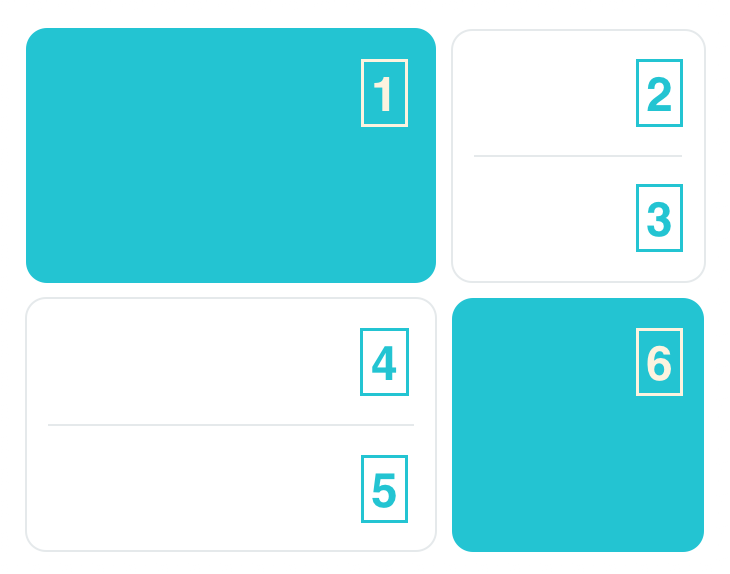

# 客製化設計

## 客製化區塊

服務我們提供了三大區塊供開發者定義屬於該區塊的內容，分別是：

- 我的服務
- 服務馬賽克拼
- 熱門

### 我的服務

我們提供了 flutter list 讓開發者可以在 list 中定義服務列表中所有服務的 icon 圖案與服務標題。

可定義 Model 位於：

- `/lib/page/city_service/model/my_service_model.dart`：
  - `enum MyServiceItemId` 定義各個 My Service enum。
  - enum extension `MyServiceIdExt` 中，根據各個 `MyServiceItemId` enum 輸出對應的 `MyServiceItem` 物件。

提示

icon 圖案我們會建議以 svg 的格式將圖檔放在專案的 `/assets/svg` 中，並且以 snake_case 的方式去命名圖檔。

ex: `icon_zoo.svg`

在 list 中我們針對服務按鈕要使用 icon 時就可以透過 `Assets.svg.{camelCase}.svg()` 讀取圖檔。

ex: `Assets.svg.iconZoo.svg()`

範例：

dart

```
// /lib/page/city_service/model/my_service_model.dart

enum MyServiceItemId {
  districtOffice,
  dashboard,
  locationSearch,
}

extension MyServiceIdExt on MyServiceItemId {
  MyServiceItem get item {
    return switch (this) {
      MyServiceItemId.districtOffice => MyServiceItem(
          title: '申辦服務',
          description: '線上申辦市政府服務個項目（市民）',
          icon: Assets.svg.iconDistrictOffice.svg(),
          category: MyServiceCategory.cityService,
          destinationUrl: 'https://taipei-pass-service.vercel.app/',
        ),
      MyServiceItemId.dashboard => MyServiceItem(
          title: '市民儀表板',
          description: '提供臺北市生活的重要數據',
          icon: Assets.svg.iconDashboardPerson.svg(),
          category: MyServiceCategory.cityService,
          destinationUrl: 'https://dashboard.gov.taipei/',
        ),
      MyServiceItemId.locationSearch => MyServiceItem(
          title: '找地點',
          description: '提供各區日常服務地圖查找',
          icon: Assets.svg.iconLocationSearch24.svg(),
          category: MyServiceCategory.explore,
          destinationUrl: 'https://taipei-pass-service.vercel.app/surrounding-service/',
        ),
      ...
    }
  }
}
```

#### 我的服務-data

| 欄位 | 用途 | 範例 |
| --- | --- | --- |
| title | 服務名稱 | 申請服務 |
| description | 簡介，顯示於 [更多服務/編輯頁面] | 線上申辦市政府服務個項目（市民） |
| icon | 服務 icon | Assets.svg.iconDistrictOffice.svg() |
| category | 服務類別 | MyServiceCategory.cityService |
| destinationUrl | 服務網址 | [https://taipei-pass-service.vercel.app/](https://taipei-pass-service.vercel.app/) |

### 服務馬賽克拼

透過 JSON，讓開發者可針對其六個區塊的文字做客製化設定。

完整 JSON 格式如下：

json

```
// /assets/mock_data/mosaic_tile_service.json

{
  "data": [
    {
      "main_text": "市政服務",
      "sub_text": "Service",
      "icon": "assets/svg/Illustrations_gov.svg",
      "destination_url": ""
    },
    {
      "main_text": "有話要說",
      "sub_text": "19992",
      "icon": "assets/svg/icon_more.svg",
      "destination_url": ""
    },
    {
      "main_text": "警政報警",
      "sub_text": "Police",
      "icon": "assets/svg/icon_more.svg",
      "destination_url": ""
    },
    {
      "main_text": "防疫醫療",
      "sub_text": "Health",
      "icon": "assets/svg/icon_covid_medical.svg",
      "destination_url": ""
    },
    {
      "main_text": "市政APP",
      "sub_text": "More",
      "icon": "assets/svg/icon_more.svg",
      "destination_url": ""
    },
    {
      "main_text": "城市生活",
      "sub_text": "City Life",
      "icon": "assets/svg/Illustrations_chair.svg",
      "destination_url": ""
    }
  ]
}
```

因其形狀設計，請務必於 `data` 放滿 6 個物件。若判定格式未符合，將會採用預設馬賽克拼做顯示。  
 順序見下示意圖：



#### 服務馬賽克拼-data

| 欄位 | 用途 | 範例 |
| --- | --- | --- |
| main_text | 區塊標題 | 市政服務 |
| sub_text | 區塊副標 | Service |
| icon | 區塊圖示 | assets/svg/Illustrations_gov.svg |
| destination_url | 服務網址 | [https://taipei-pass-service.vercel.app/](https://taipei-pass-service.vercel.app/) |

### 熱門

我們提供了 flutter list 讓開發者可以在 list 中定義熱門服務列表的 icon 圖案、服務標題與點擊後導至的網頁。

可定義 list 位於 `/lib/page/city_service/model/trending_service_model.dart`。

提示

icon 圖案我們會建議以 svg 的格式將圖檔放在專案的 `/assets/svg` 中，並且以 snake_case 的方式去命名圖檔。

ex: `icon_dashboard_reports.svg`

在 list 中我們針對服務按鈕要使用 icon 時就可以透過 `Assets.svg.{camelCase}.svg()` 讀取圖檔。

ex: `Assets.svg.iconDashboardReports.svg()`

範例：

dart

```
// /lib/page/city_service/model/trending_service_model.dart

abstract final class TrendingServiceModel {
  static List<TrendingService> get serviceList {
    return [
      TrendingService(
        title: '找地點',
        icon: Assets.svg.iconLocationSearch.svg(),
        url: 'https://taipei-pass-service.vercel.app/surrounding-service/',
      ),
      TrendingService(
        title: '市民儀表板',
        icon: Assets.svg.iconDashboardReports.svg(),
        url: 'https://dashboard.gov.taipei/',
      ),
      // more...
    ];
  }
}
```

#### 熱門服務-data

| 欄位 | 用途 | 範例 |
| --- | --- | --- |
| title | 服務名稱 | 市民儀表板 |
| icon | 服務 icon | Assets.svg.iconDashboardReports.svg() |
| destinationUrl | 服務網址 | [https://dashboard.gov.taipei/](https://dashboard.gov.taipei/) |
