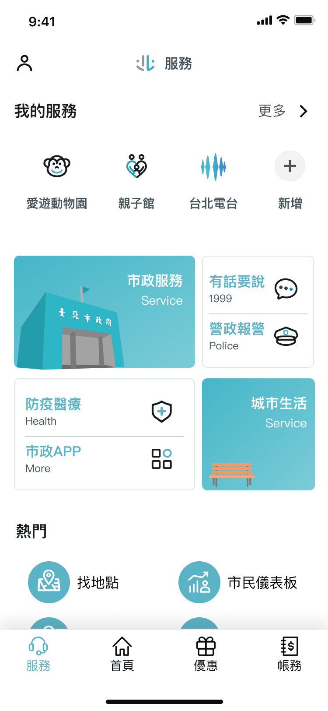
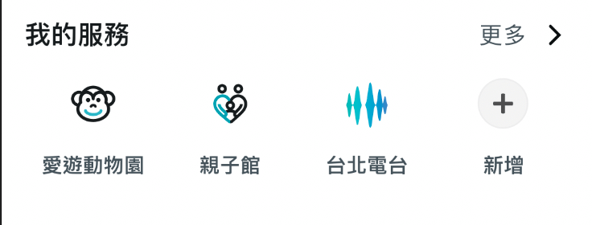
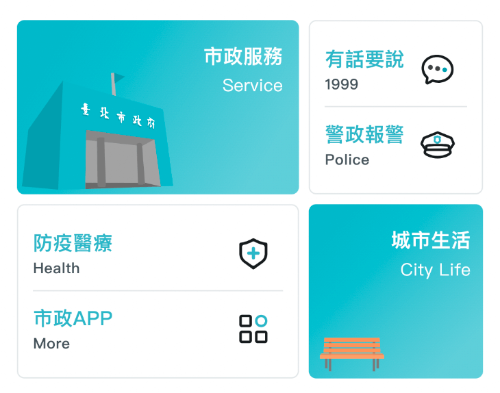
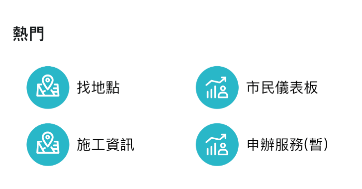

# 介面

## 介面介紹

服務主要呈現多項市政服務。使用者可於頁面上方便找尋當前想使用之服務，也可在「我的服務」中選擇自己常用的服務以便未來快速使用。

### 我的服務

我的服務區塊顯示了使用者在服務列表中挑選想要置頂的服務，方便使用者快速使用這些自己常用的服務。

透過更多與新增按鈕，使用者可以進入服務列表新增、刪除屬於自己的置頂服務。

我們在專案中提供了區塊讓開發者可以去定義服務列表中的服務，想了解詳情可至[客製化設計-我的服務](custom-design.md#我的服務)，會有更詳細說明。

### 服務馬賽克拼

介面中央區塊透過看似不規則的方格排列，將重要市政服務呈現於此，不只吸引使用者目光，更讓使用者可以快速使用這些便利服務。

我們在專案中提供了區塊讓開發者可以去定義要拼接的服務，想了解詳情可至[客製化設計-服務馬賽克拼](custom-design.md#服務馬賽克拼)，會有更詳細說明。

### 熱門

熱門呈現了所有服務中，使用次數較高的前幾名服務，讓使用者一目瞭然，並可以快速使用。

我們在專案中提供了區塊讓開發者可以去定義熱門服務，想了解詳情可至[客製化設計-熱門](custom-design.md#熱門)，會有更詳細說明。

