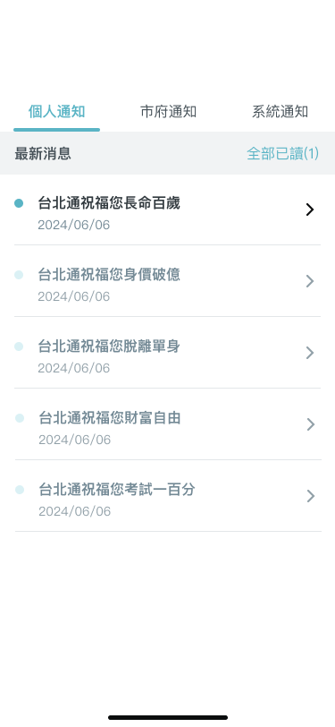
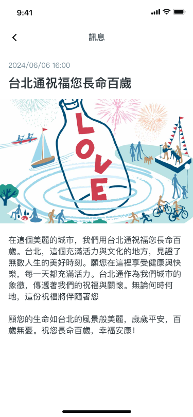

# 客製化設計

## 客製化區塊

個人設定我們提供了個人訊息的 API JSON，讓開發者自行決定各種訊息的內容、圖片與相關連結。

### 個人訊息

個人訊息可以讓使用者瀏覽不同類型的相關訊息，分別為**個人通知**、**市府訊息**、**系統訊息**，他們在 JSON 中個別用 `type` 欄位定義，分別是 `PERSONAL`、`TCG` 與 `SYSTEM`。

點擊訊息進入訊息內頁，可以觀看訊息詳細內容、圖片或是相關連結。

透過 JSON 可以定義訊息的標題、訊息時間、是否已讀、圖片連結，以及透過 rich_text 去設定訊息相關詳細內容。





**詳細內容是按照 rich_text 中的順序去排版文字與連結，所以在設計時記得要按照想像的排版去決定 rich_text 內容的順序。**

完整 JSON 格式如下

json

```
{
  "data": [
    {
      "title": "113年端午節前台北市節慶商品物價變動", // 訊息標題
      "datetime": 1717751400, // 訊息時間
      "type": "TCG", // 訊息類型
      "has_read": false, // 是否已讀
      "image_url": "https://taipeipass-jrsys.cdn.hinet.net/images/9d6882be-6eb0-40f0-88d6-92642364193e", // 訊息圖片來源連結
      "rich_text": [ // 訊息內容
        {
          "text": "比較臺北市113年端午節連續假期前三天與上年同期節慶商品物價，花生(仁)、栗子、鹹鴨蛋及糯米因部分業者反映進貨成本增加、鹹肉粽及甜粽因人工成本上升、豬肉因飼養成本增加，致價格上漲；至乾香菇、蝦米及粽葉，則因供量充足，致價格下跌。\n\n\uD83D\uDC49相關訊息：\n為反映113年臺北市端午節前節慶商品物價情況，臺北市政府主計處分別於113年5月9日(假期前三十天)、5月29日(假期前十天)及6月5日(假期前三天)，辦理豬肉、糯米、乾香菇、栗子、鹹鴨蛋、鹹肉粽、甜粽、蝦米、粽葉及花生(仁)等具代表性項目商品之零售價格訪查工作，嗣經統計分析後，於市府主計處網站發布新聞稿，以供各界參考。\n\n\uD83D\uDC49更多資訊：\n\uD83D\uDD39《臺北市節慶物價新聞稿專區》\n"
        },
        {
          "url": "https://dbas.gov.taipei/News.aspx?n=203701D77DBBB1AE&sms=8832E8D105359ABA"
        },
        {
          "text": "\n\uD83D\uDD39《臺北市物價統計專區》\n",
          "style": [
            "ITLIC"
          ]
        },
        {
          "url": "https://dbas.gov.taipei/cp.aspx?n=3075BAC358599F47"
        }
      ]
    },
    {
      "title": "【系統維護完成通知】即日起開放「城市通-健康集點」兌點服務。",
      "datetime": 1717486800,
      "type": "TCG",
      "has_read": true,
      "image_url": "https://taipeipass-jrsys.cdn.hinet.net/images/654e4df8-89a3-4131-bbc2-9ff32c2fd30b",
      "rich_text": [
        {
          "text": "親愛的市民您好！\n點數兌換系統已完成維護，即日起重新開放「城市通-健康集點」兌點服務，點數兌換期限至113年10月31日止，請盡早完成兌換，若有兌點相關問題，請於上班時間撥打02-27208889分機7112洽詢，將由專人協助您。\n\uD83D\uDC49集點兌換悠遊卡加值金資訊查詢："
        },
        {
          "url": "https://reurl.cc/97R6qY"
        }
      ]
    },
    {
      "title": "城市通祝福您生日快樂",
      "datetime": 1692493200,
      "type": "PERSONAL",
      "has_read": false,
      "rich_text": [
        {
          "text": "親愛的城市通會員您好\n在這美好又特別的一天，獻上給您的祝福。\n生日快樂\uD83C\uDF89祝福您天天都有好的心情～\n城市通與您一同成長，\n未來將有更多多元的市政服務歡迎您一同體驗！\n臺北市政府 敬賀"
        }
      ]
    }
  ]
}
```

#### 個人訊息-data

| 欄位 | 用途 | 範例 |
| --- | --- | --- |
| title | 訊息標題 | 113年端午節前台北市節慶商品物價變動 |
| datetime | 訊息時間，timestamp 格式 | 1717751400 |
| type | 訊息類型 | TCG |
| has_read | 是否已讀 | false |
| image_url | 訊息圖片來源連結 | [https://taipeipass-jrsys.cdn.hinet.net/images/9d6882be-6eb0-40f0-88d6-92642364193e](https://taipeipass-jrsys.cdn.hinet.net/images/9d6882be-6eb0-40f0-88d6-92642364193e) |
| rich_text | 訊息內容 | 參考[個人訊息-rich-text](custom-design.md#個人訊息-rich-text) |

#### 個人訊息-rich-text

| 欄位 | 用途 | 範例 |
| --- | --- | --- |
| text | 純文字內容，可以加上 Unicode code points 添加特定 icon | 親愛的市民您好！\n點數兌換系統已完成維護，即日起重新開放「城市通-健康集點」兌點服務，點數兌換期限至113年10月31日止，請盡早完成兌換，若有兌點相關問題，請於上班時間撥打02-27208889分機7112洽詢，將由專人協助您。\n\uD83D\uDC49集點兌換悠遊卡加值金資訊查詢： |
| style | 設定文字效果(斜體、粗體、底線) | "ITALIC", "BOLD", "UNDERLINE" |
| url | 添加在內文的網址連結 | [https://reurl.cc/97R6qY](https://reurl.cc/97R6qY) |

更詳盡內容請至 [客製化設計 - rich-text 富文本](../custom/rich-text.md) 查看
