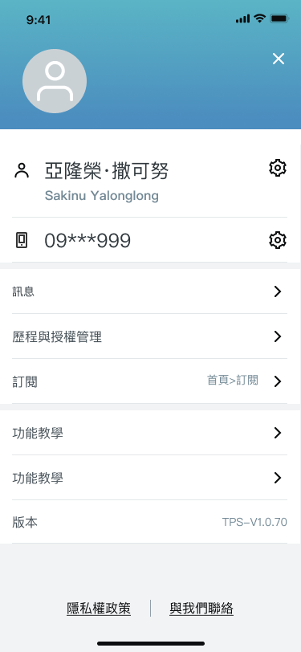
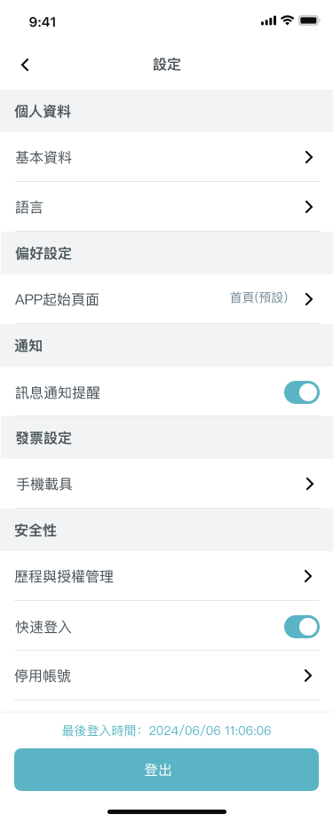
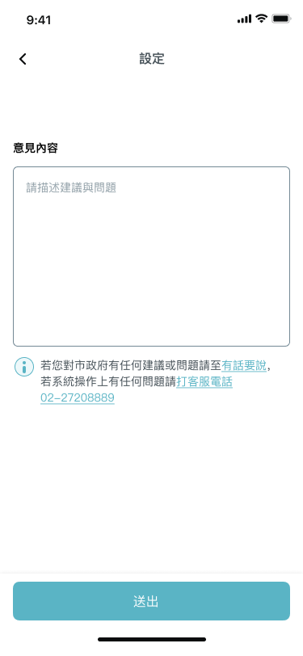
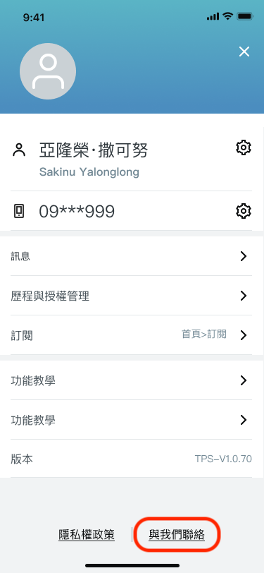

# 介面

## 介面介紹

個人帳號頁面呈現了，使用者個人基本資訊、相關個人設定連結與 app 版本資訊。

### 個人設定

個人設定包含各種設定，例如：基本資料、語言等。

所有設定按鈕皆可以自由設定，每個按鈕規則都會透過點擊 navigate 到對應頁面，保留此彈性讓開發者可以按照想像與需求增減設定按鈕。

相關按鈕設定可以至 `lib/page/account/setting/tp_setting_list.dart` 做設定。

### 訊息

訊息區塊包含了客製化 API 設計，想了解詳情可至[客製化設計](custom-design.md)，會有更詳細說明。

### 意見回饋

個人意見可以透過意見回饋將各種類型的相關建議回饋給市府。

### 與我們聯絡

使用者可透過與我們聯絡按鈕寄送信件，取得協助。

