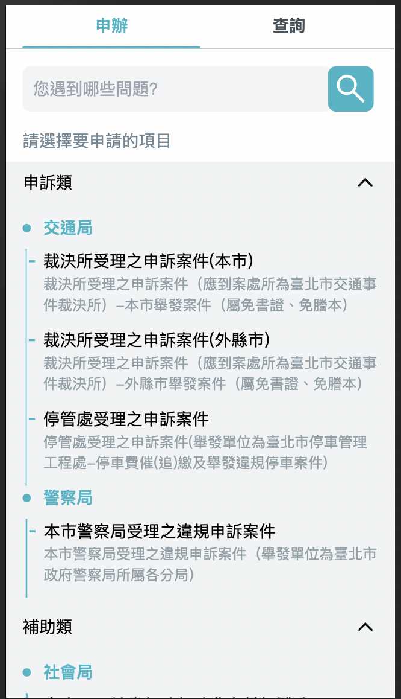
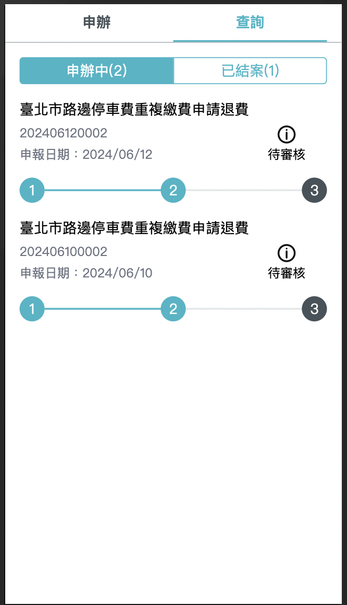
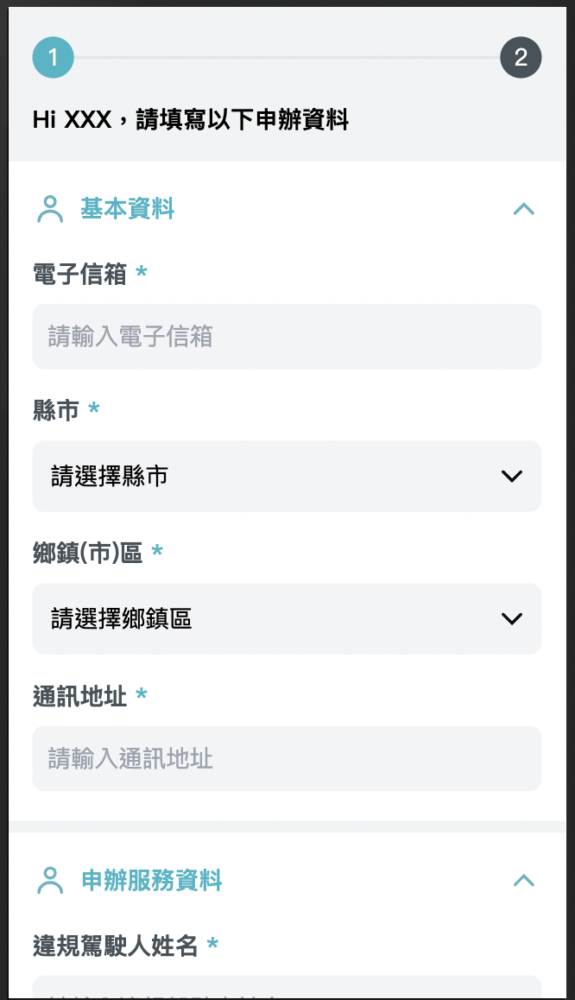
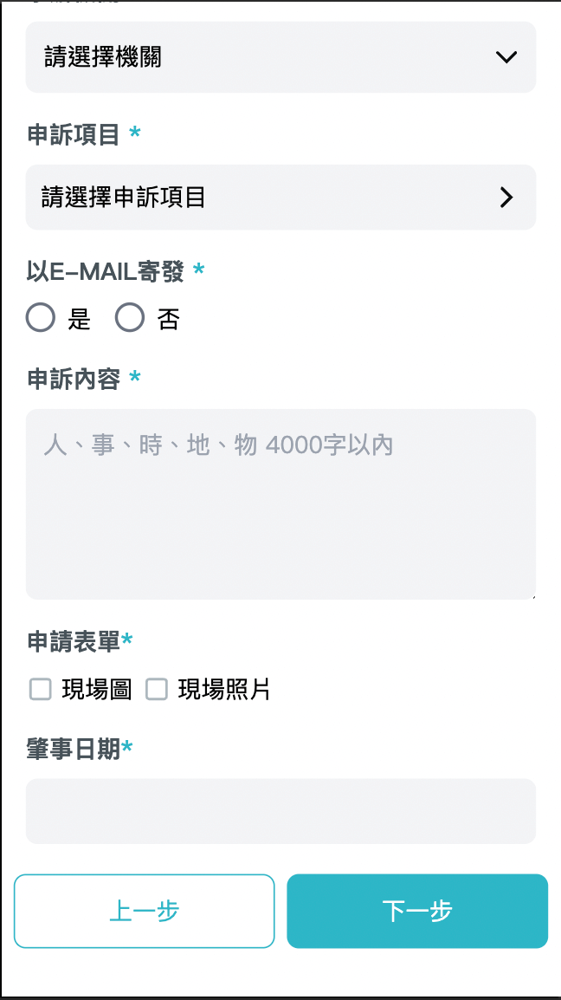
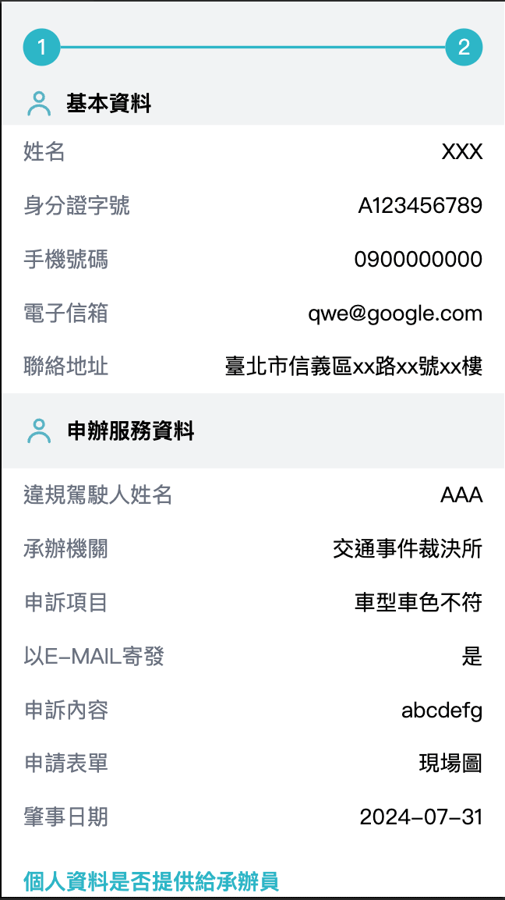
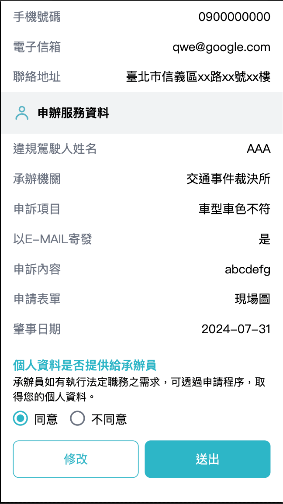

# 用戶介面

## 概述

在尚未開發之前先來了解一下專案頁面規劃與設計。

💡 提示

在前端框架中也有組件(Component)的概念，將應用程式拆成數個較小的模組，以更輕易構建使用者介面，並提高復用性。

## /home

主頁面共有兩個 Tab 分別為**申辦**與**查詢**

- 申辦呈現所有可申辦之服務，透過種類與相關所屬機關做分類，點擊細項的服務項目，可以將使用者導頁至表單頁面。 另有服務標題模糊查詢功能，方便使用者更快速找出他們所需要的服務。

- 查詢呈現目前申辦中與已結案的案件。  
此頁面需要串接後端 API，詳細可以前往 [進度查詢](case-progress.md) 瞭解。

## /form/:id

表單頁會根據在主頁面點擊服務項目後導轉時所帶上的 id ，透過 API 查找該項目所需要的表單組成，表單主要分為兩大區塊：

- 基本資料
- 申辦服務資料

基本資料是大家都一樣的，透過 API 組成的會是申辦服務資料，可以透過我們已經制定好的 API response JSON 格式來組出這一區塊所需要的表單欄位。

表單元件另外提供必填驗證，只要該欄位是必填，在點擊下一步送出時，會去驗證所有必填欄位，並提示使用者尚未填寫的欄位，若全部欄位填寫無誤，會呈現預覽畫面供使用者確認。

