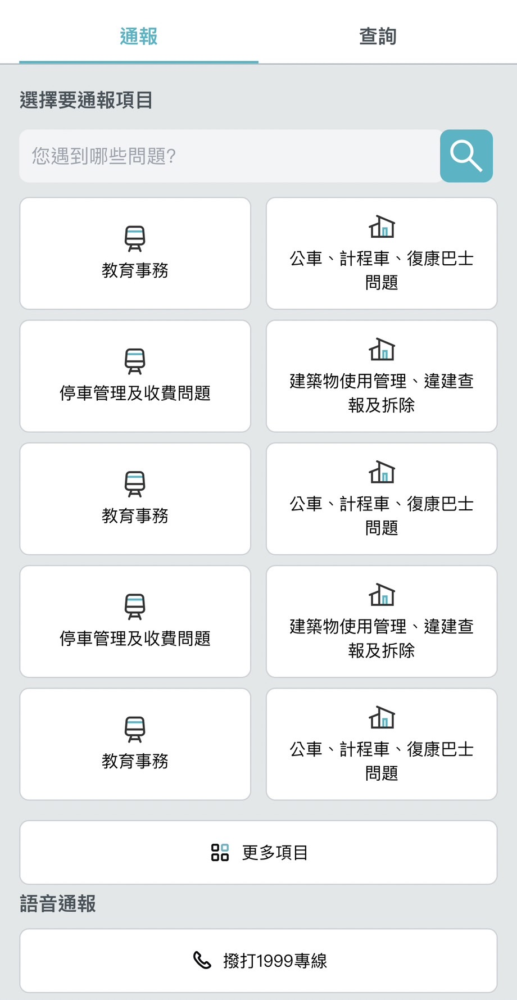
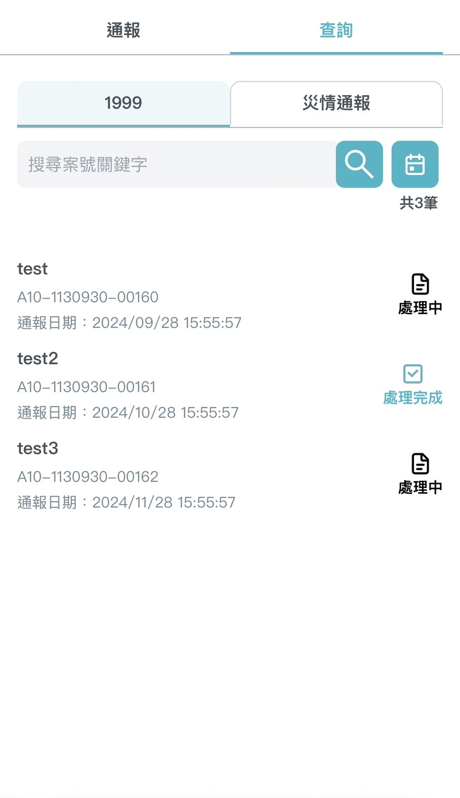
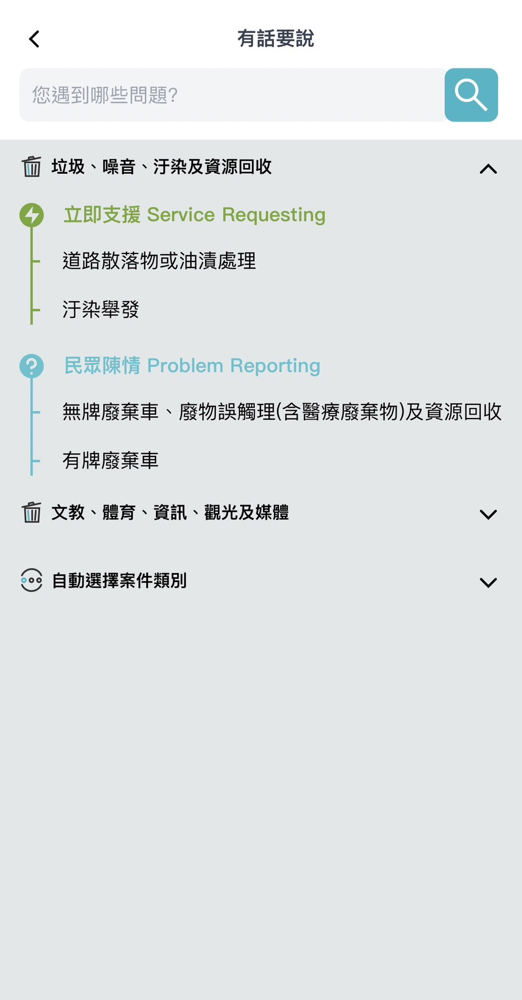
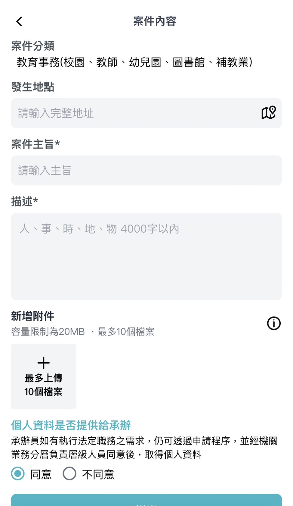
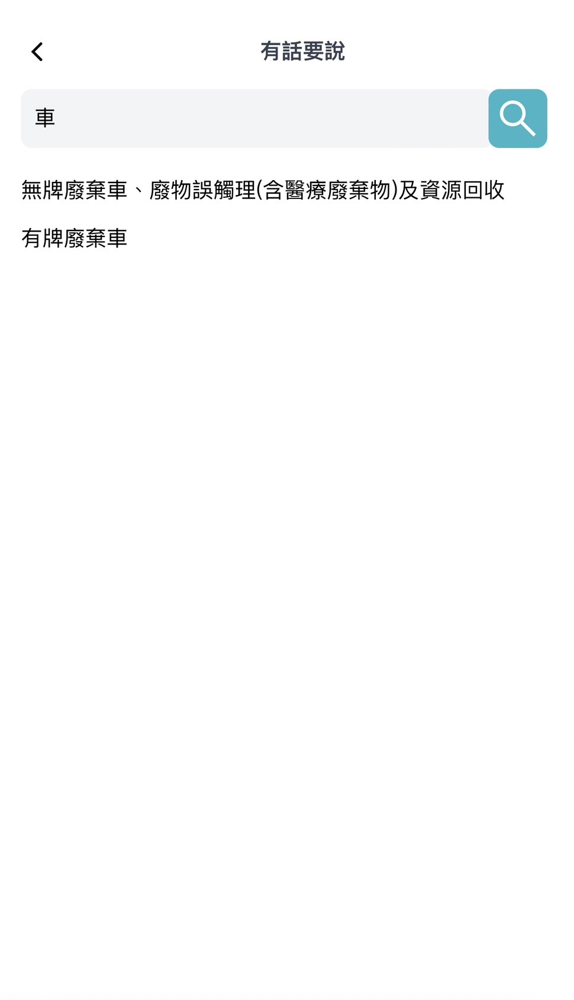
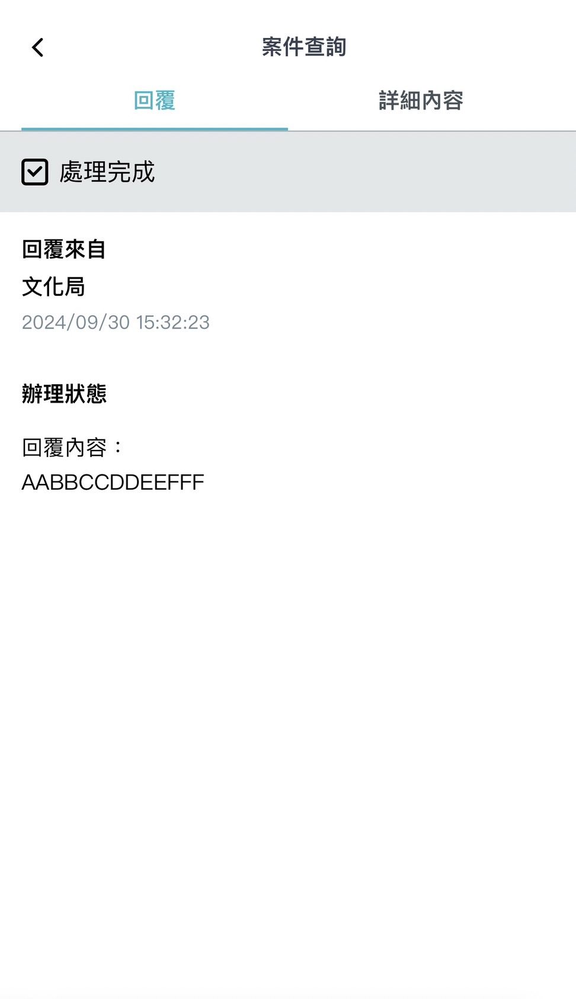
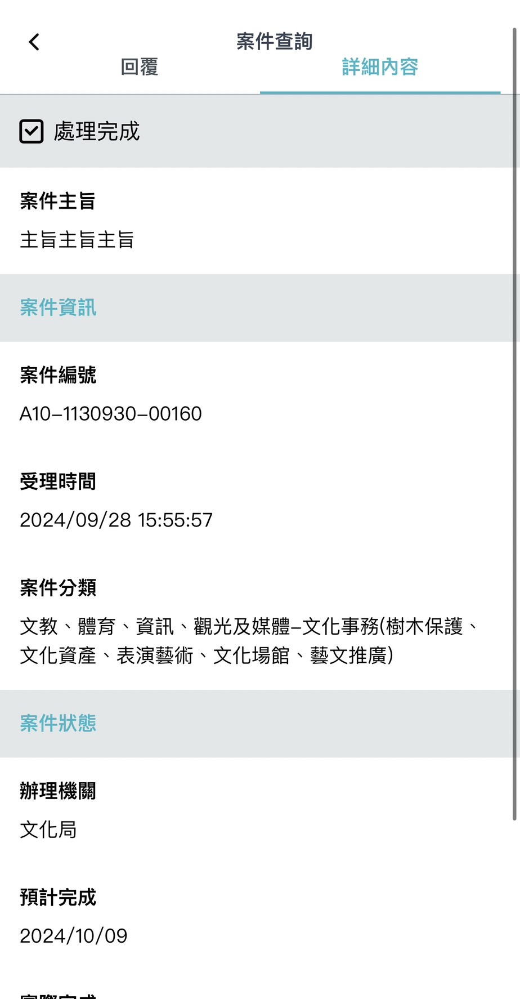

# 用戶介面

## 概述

在尚未開發之前先來了解一下專案頁面規劃與設計。

💡 提示

在前端框架中也有組件(Component)的概念，將應用程式拆成數個較小的模組，以更輕易構建使用者介面，並提高復用性。

## /citizen-report

此頁主要分為通報與查詢兩個 tab。

通報 tab 顯示熱門的通報服務項目，點擊按鈕後可以快速前往該項目的通報表單。

也可以點擊更多項目，查看所有的通報類型。

點擊 1999 專線按鈕可以快速撥打專線。

查詢 tab 底下有分 1999 與災情通報兩種分類，不同的通報類型會自動分類在此兩大分類底下。

可以快速得知通報的事件進度。

## /citizen-report/list

此頁將所有通報項目根據大分類呈現出來，使用者可以根據需通報的類型找到對應表單項目。

## /citizen-report/form/:id

此頁為通報的表單頁，使用者在表單中填入通報內容，並提交。

## /citizen-report/search

此頁可以根據關鍵字模糊搜尋通報項目，讓使用者快速搜尋到需通報的項目。

## /citizen-report/search-detail/:id

此頁是通報項目進度查詢的詳細頁面，可以在這裡了解通報的進度與相關單位回覆的內容。

