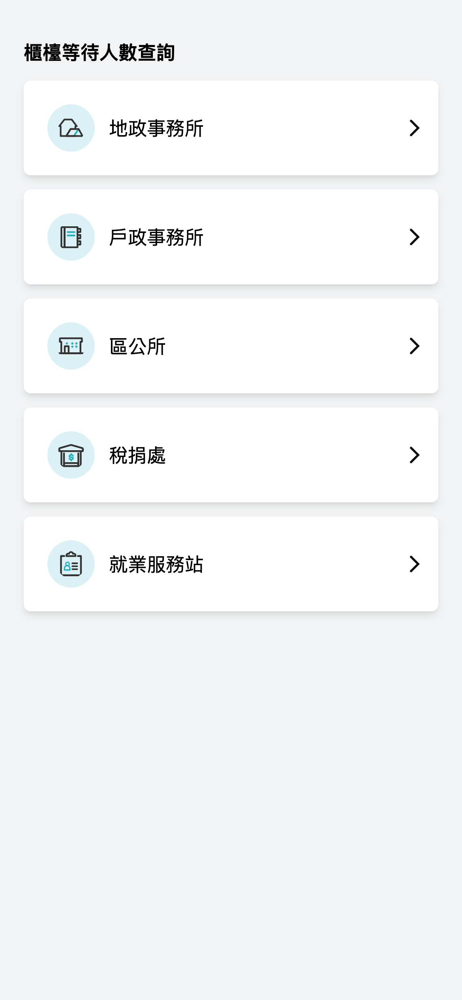
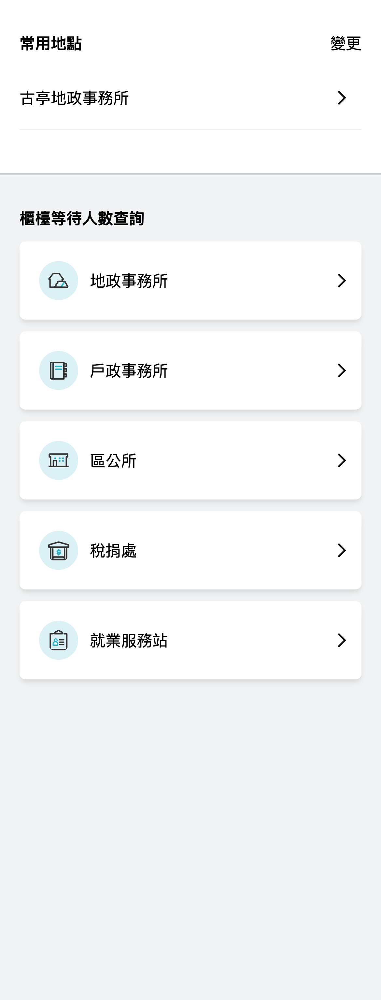
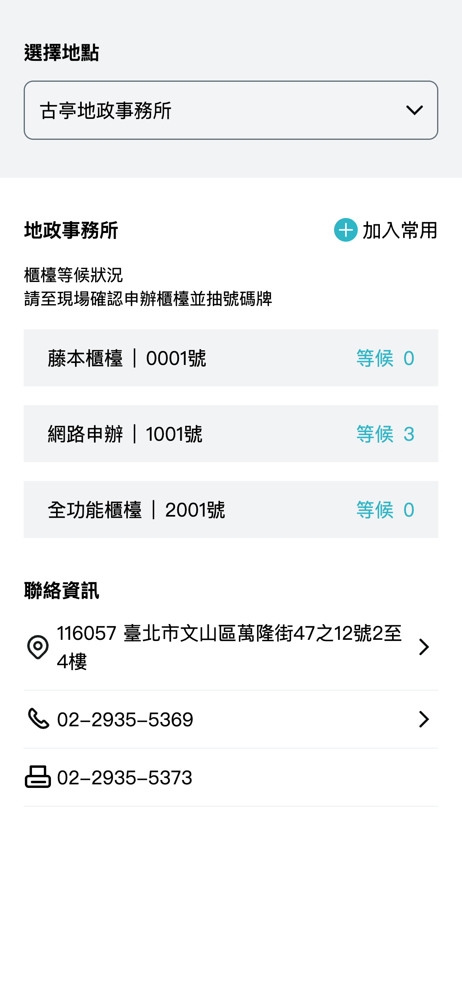

# 用戶介面

## 概述

在尚未開發之前先來了解一下專案頁面規劃與設計。

💡 提示

在前端框架中也有組件(Component)的概念，將應用程式拆成數個較小的模組，以更輕易構建使用者介面，並提高復用性。

## /counter-calling

此頁面將會展示不同服務項目的各機關列表。點選進入所選機關的詳細頁面。

如有新增常用地點，則會將常用地點列表顯示在最上方。

## /counter-calling/:id

此頁呈現所選機關的詳細頁面，顯示所選機關櫃檯的即時叫號情況與等待人數。 並可切換上方下拉選單，查看不同服務地點。 也可選擇將此地點加入常用，返回主頁後就會看到常用地點列表。

