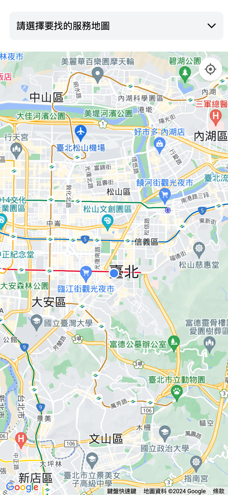
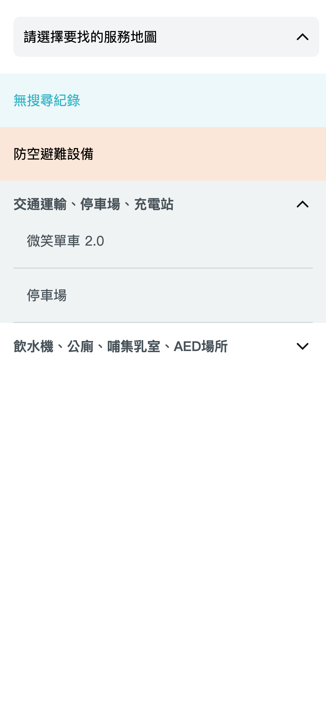
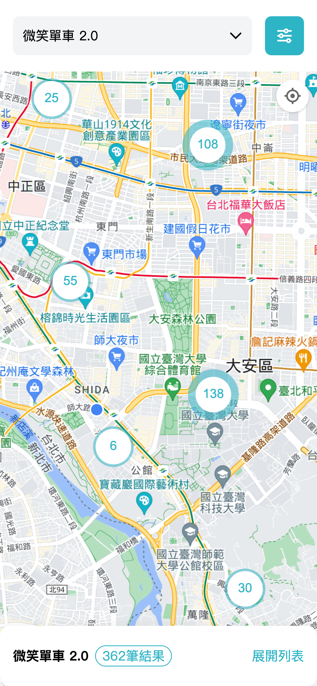
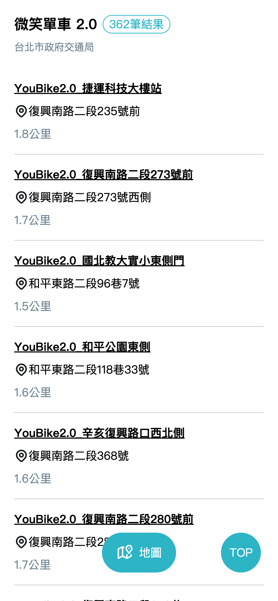
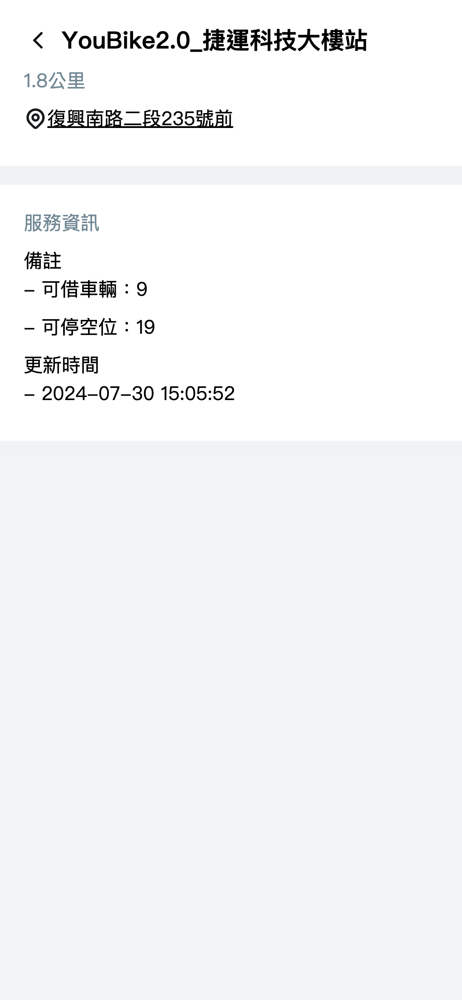

# 用戶介面

## /surrounding-service

### 找地點初始頁面

- 選擇並點選欲尋找的服務之後，會於目前視窗範圍內的地圖上顯示地點。 

### 點選請選擇要找的服務地圖，展開選單

- 選擇並點選欲尋找的服務，如有選擇紀錄，則會呈現在上方紀錄列(淺藍底); 如無紀錄，則顯示"無搜尋紀錄"。 

### 找地點呈現資料

- 查詢呈現目前找到的地點，並可點擊展開列表，將搜尋到的地點條列顯示。  
此頁面資料來源可為 API 或是靜態 JSON，詳細可以前往 [資料呈現](data.md) 瞭解。 

### 地圖列表

- 點選下方地圖按鈕，即可返回地圖頁。
- 點選一筆地點，則進入該地點的詳細資訊頁。 

### 地點詳細資訊

