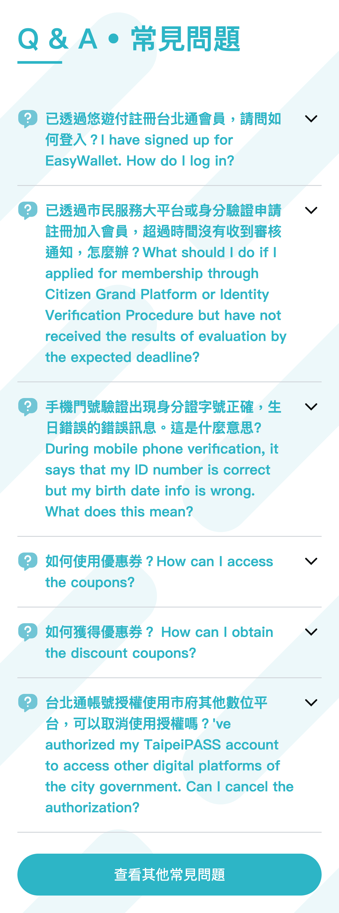
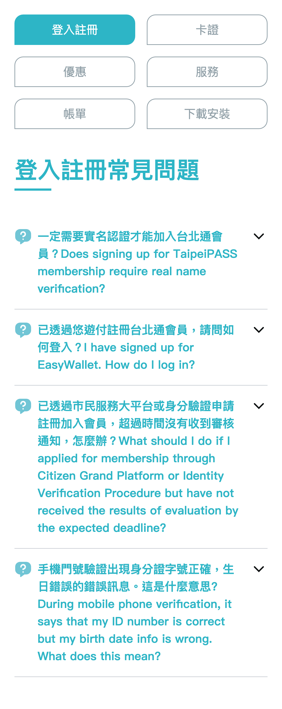

# 用戶介面

## 概述

在尚未開發之前先來了解一下專案頁面規劃與設計

💡 提示

在前端框架中也有組件(Component)的概念，將應用程式拆成數個較小的模組，以更輕易構建使用者介面，並提高復用性。

## /qna

此頁面會精選要放在第一頁的常見問題。  
 點選**查看其他常見問題**，會進入/qna/categories，顯示所有常見問題。

## /qna/categories

此頁呈現所有的問題，並可自訂分類，更方便查找解答。

