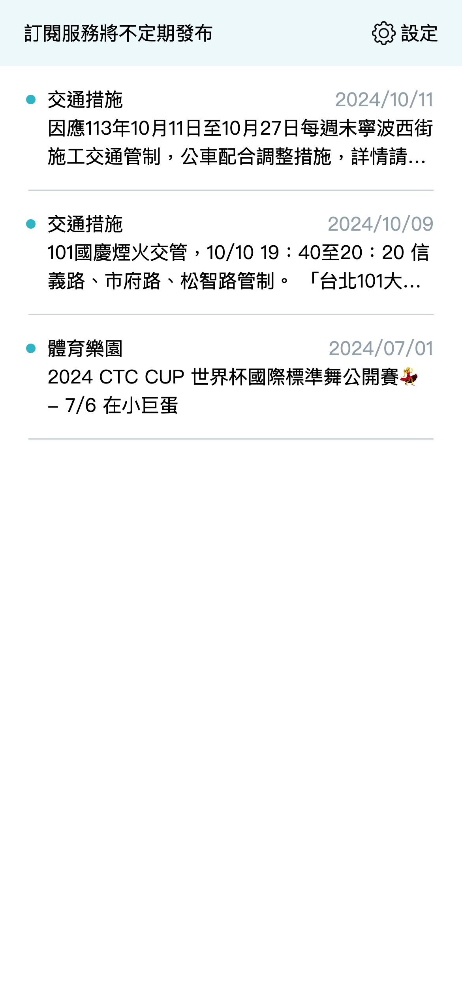
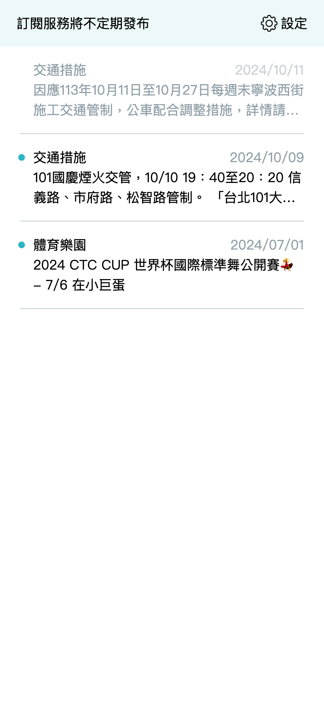

# 訂閱列表

從城市通首頁的訂閱區塊右邊，點選更多，即可進入已訂閱的訊息列表視窗，這邊呈現所有已訂閱的服務之推播訊息。

## /subscription/item-list



已閱讀的訊息會呈現灰階色彩; 未閱讀的訊息在訊息左方呈現一個圓點，標示尚未讀取。



# 資料呈現

## API 設計

關於訂閱列表頁面，JSON 格式的欄位定義如下，開發時只需遵照規格即可。 完整 JSON 格式如下

JSON

```
{
  "//": "市政訊息已訂閱列表",
  "data": [
    {
      "id": "sub-item-1",
      "type_id": "sub-3",
      "type_name": "交通措施",
      "is_read": false,
      "date": "2024/10/11",
      "description": "因應113年10月11日至10月27日每週末寧波西街施工交通管制，公車配合調整措施，詳情請見公運處新聞稿\n<a href='https://pto.gov.taipei/News_Content.aspx?n=D065CCB1467288C8&s=38C541A6FB02530E&sms=72544237BBE4C5F6' target='_blank'>https://pto.gov.taipei/News_Content.aspx?n=D065CCB1467288C8&s=38C541A6FB02530E&sms=72544237BBE4C5F6</a>"
    },
    {
      "id": "sub-item-2",
      "type_id": "sub-3",
      "type_name": "交通措施",
      "is_read": false,
      "date": "2024/10/09",
      "description": "101國慶煙火交管，10/10 19：40至20：20 信義路、市府路、松智路管制。 「台北101大樓施放國慶煙火」安全管制措施，請見市府資訊網：\n<a href='https://pto.gov.taipei/News_Content.aspx?n=D065CCB1467288C8&s=38C541A6FB02530E&sms=72544237BBE4C5F6' target='_blank'>https://pto.gov.taipei/News_Content.aspx?n=D065CCB1467288C8&s=38C541A6FB02530E&sms=72544237BBE4C5F6</a>"
    },
      {
        "id": "sub-item-3",
        "type_id": "sub-1",
        "type_name": "體育樂園",
        "is_read": false,
        "date": "2024/07/01",
        "description": "2024 CTC CUP 世界杯國際標準舞公開賽💃 - 7/6 在小巨蛋"
      }
  ]
}
```

## 資料欄位說明

#### data

| 欄位 | 用途 | 範例 |
| --- | --- | --- |
| id | 訂閱服務訊息 id | sub-item-1 |
| type_id | 訂閱服務類型 id | sub-3 |
| type_name | 訂閱服務類型名稱 | 交通措施 |
| is_read | 是否已閱讀 | true/false |
| date | 訊息推播時間 | 2024/10/09 |
| description | 訂閱服務訊息內，可傳入 HTML 格式，以呈現連結等內容 | 因應113年10月11日至10月27日每週末寧波西街施工交通管制，... |
