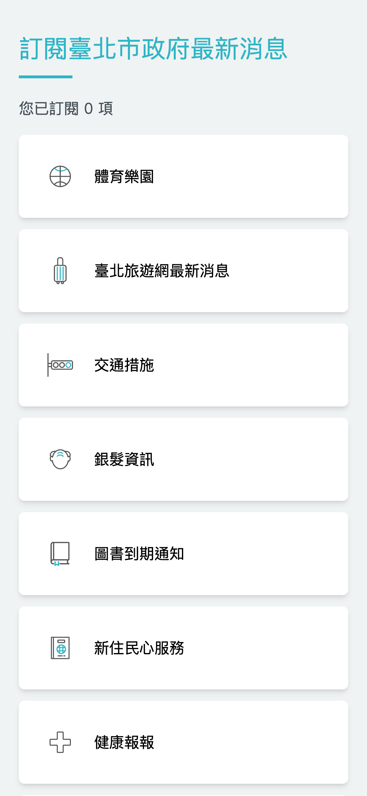
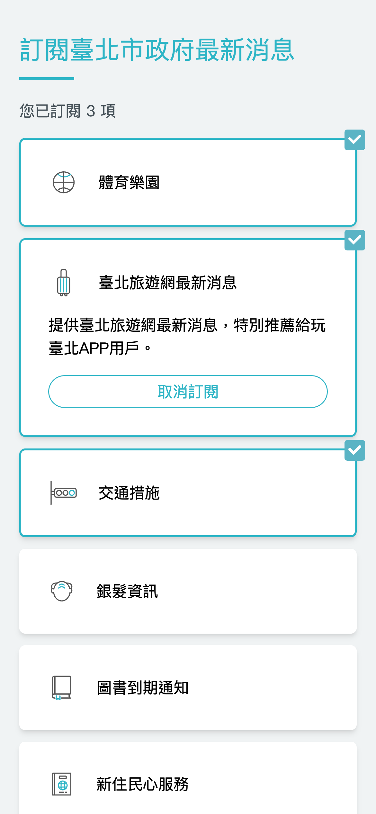

# 訂閱主頁

## /subscription

此頁面將會展示所有訂閱服務列表。



點選展開詳細說明與訂閱按鈕，已訂閱項目於方框右上方會有一個勾，並統計總訂閱項目數於左上方。 

# 資料呈現

## API 設計

關於市政訊息訂閱主頁面，JSON 格式的欄位定義如下，開發時只需遵照規格即可。 完整 JSON 格式如下

JSON

```
{
  "//": "市政訊息訂閱",
  "data": {
    "submit_target": {
      "url": "https://example.api/",
      "method": "POST",
      "content_type": "application/json"
    },
    "data": [
      {
        "id": "sub-1",
        "name": "體育樂園",
        "is_subscribed": false,
        "is_expand": false,
        "icon": "/images/subscription/icon_sports_park.svg",
        "description": "提供臺北市最新體育賽事活動資訊及運動場館租借服務。"
      },
      {
        "id": "sub-2",
        "name": "臺北旅遊網最新消息",
        "is_subscribed": false,
        "is_expand": false,
        "icon": "/images/subscription/icon_taipei_travelnews.svg",
        "description": "提供臺北旅遊網最新消息，特別推薦給玩臺北APP用戶。"
      },
      {
        "id": "sub-3",
        "name": "交通措施",
        "is_subscribed": false,
        "is_expand": false,
        "icon": "/images/subscription/icon_traffic_info.svg",
        "description": "提供用路人臺北市交通管制訊息。"
      },
      {
        "id": "sub-4",
        "name": "銀髮資訊",
        "is_subscribed": false,
        "is_expand": false,
        "icon": "/images/subscription/icon_senior_info.svg",
        "description": "提供銀髮多元福利資訊，幫助長者依各自需求做選擇。"
      },
      {
        "id": "sub-5",
        "name": "圖書到期通知",
        "is_subscribed": false,
        "is_expand": false,
        "icon": "/images/subscription/icon_library_subscription.svg",
        "description": "本服務讓您輕鬆獲得逾期催還、預約書到館、借閱資料即將到期通知，掌握圖書資料借閱狀況。"
      },
      {
        "id": "sub-6",
        "name": "新住民心服務",
        "is_subscribed": false,
        "is_expand": false,
        "icon": "/images/subscription/icon_migrant_support.svg",
        "description": "想知道新移民大小事嗎？提供您各項活動和課程訊息哦！"
      },
      {
        "id": "sub-7",
        "name": "健康報報",
        "is_subscribed": false,
        "is_expand": false,
        "icon": "/images/subscription/icon_health_info.svg",
        "description": "提供健康撇步及市民篩檢通知。"
      },
      {
        "id": "sub-8",
        "name": "停車費通知",
        "is_subscribed": false,
        "is_expand": false,
        "icon": "/images/subscription/icon_parking.svg",
        "description": "繳費到期前3天收到台北市路邊停車費通知。"
      },
      {
        "id": "sub-9",
        "name": "空品資訊",
        "is_subscribed": false,
        "is_expand": false,
        "icon": "/images/subscription/icon_air_quality.svg",
        "description": "每天早上8點提供區域內之空氣品質動態變化，幫助您規劃日常生活。"
      },
      {
        "id": "sub-10",
        "name": "防汛資訊",
        "is_subscribed": false,
        "is_expand": false,
        "icon": "/images/subscription/icon_flood_info.svg",
        "description": "於颱風期間提供水情、災情、紅黃線停車、淹水警示、水閘門啟閉等資訊。"
      }
    ]
  }
}
```

## 資料欄位說明

### 市政訊息訂閱

| 欄位 | 用途 | 範例 |
| --- | --- | --- |
| submit_target | 送出表單的目標資訊 | 參考[submit_target](main-page.md#submit_target) |
| data | 訂閱服務列表 | 參考[data](main-page.md#data) |

#### submit_target

| 欄位 | 用途 | 範例 |
| --- | --- | --- |
| url | 提交表單的目標後端 url | [https://example.api/](https://example.api/) |
| method | 提交表單時 request 方法 | POST |
| content_type | request 可接受的資料類型 | application/json |

#### data

| 欄位 | 用途 | 範例 |
| --- | --- | --- |
| id | 訂閱服務 id | sub-1 |
| name | 訂閱服務名稱 | 臺北旅遊網最新消息 |
| is_subscribed | 是否訂閱 | true/false |
| is_expand | 是否展開卡片 | true/false |
| icon | 訂閱圖示，將圖檔置於/public/images目錄下，如傳空值則無圖示 | /public/images/icon_household_office.svg |
| description | 訂閱服務說明 | 提供臺北旅遊網最新消息，特別推薦給玩臺北APP用戶。 |
