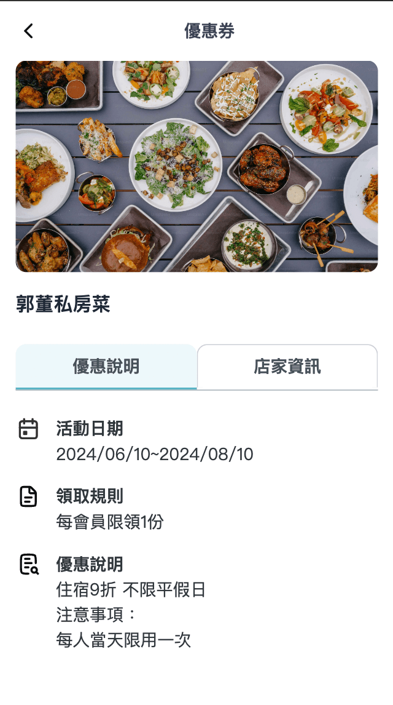
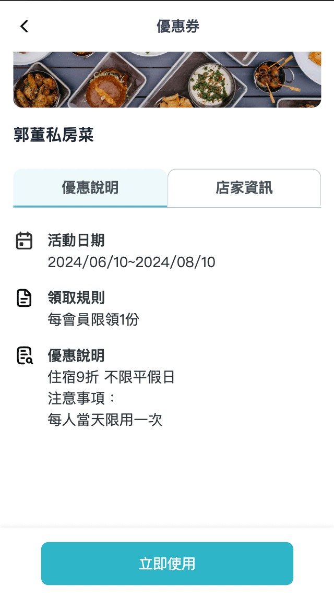
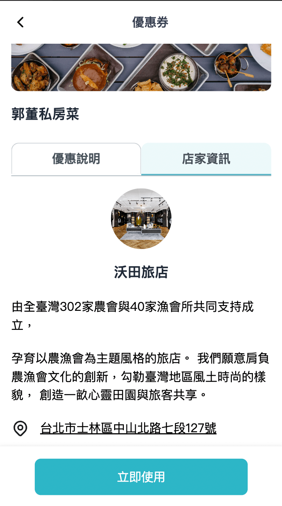
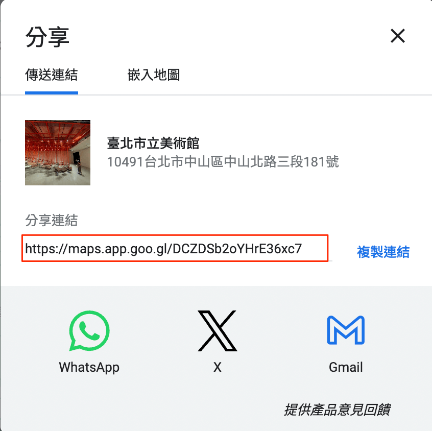

# 優惠券詳細

## /coupon/coupon-detail/:id

優惠券詳細中包含優惠說明與店家資訊。







### 優惠券-coupon_list

詳細的資料皆在主頁提到 `coupon_list` 中定義。

這邊會主要介紹詳細頁面使用的欄位，列表相關欄位在主頁有更詳細介紹，完整範例如下

json

```
{
  "data": {
    "coupon_list": [
      {
        "id": "c-1",
        "name": "郭董私房菜",
        "text": "強強聯手 - 郭董私房菜 X 國宴主廚",
        "vip_text": "",
        "discount_text": "贈粽子",
        "deadline": "2024/06/30",
        "remaining": "",
        "is_hot": true,
        "img_url": "https://plus.unsplash.com/premium_photo-1673108852141-e8c3c22a4a22?q=80&w=2070&auto=format&fit=crop&ixlib=rb-4.0.3&ixid=M3wxMjA3fDB8MHxwaG90by1wYWdlfHx8fGVufDB8fHx8fA%3D%3D",
        "activity_date": "2024/06/10~2024/08/10",
        "rule": "每會員限領1份",
        "coupon_illustrate": "住宿9折 不限平假日\n注意事項：\n每人當天限用一次",
        "store_info": {
          "img_url": "https://plus.unsplash.com/premium_photo-1661964205360-b0621b5a9366?q=80&w=2038&auto=format&fit=crop&ixlib=rb-4.0.3&ixid=M3wxMjA3fDB8MHxwaG90by1wYWdlfHx8fGVufDB8fHx8fA%3D%3D",
          "name": "沃田旅店",
          "introduce": [
            "由全臺灣302家農會與40家漁會所共同支持成立，",
            "孕育以農漁會為主題風格的旅店。\n我們願意肩負農漁會文化的創新，勾勒臺灣地區風土時尚的樣貌，\n創造一畝心靈田園與旅客共享。"
          ],
          "address": {
            "text": "台北市士林區中山北路七段127號",
            "map": "https://maps.app.goo.gl/jN5AyYmkmDsmYX547"
          }
        }
      },
      {
        "id": "c-2",
        "name": "阿爸手工皂",
        "text": "滿1000元送100元。",
        "vip_text": "",
        "discount_text": "滿千送百",
        "deadline": "2024/06/30",
        "remaining": "158",
        "is_hot": true,
        "img_url": "https://images.unsplash.com/photo-1454873019514-eae2f086587a?q=80&w=2073&auto=format&fit=crop&ixlib=rb-4.0.3&ixid=M3wxMjA3fDB8MHxwaG90by1wYWdlfHx8fGVufDB8fHx8fA%3D%3D",
        "activity_date": "2024/06/10~2024/08/10",
        "rule": "",
        "coupon_illustrate": "住宿9折 不限平假日\n注意事項：\n每人當天限用一次",
        "store_info": {
          "img_url": "https://plus.unsplash.com/premium_photo-1661964205360-b0621b5a9366?q=80&w=2038&auto=format&fit=crop&ixlib=rb-4.0.3&ixid=M3wxMjA3fDB8MHxwaG90by1wYWdlfHx8fGVufDB8fHx8fA%3D%3D",
          "name": "阿爸手工皂",
          "introduce": [
            "由全臺灣302家農會與40家漁會所共同支持成立，",
            "孕育以農漁會為主題風格的旅店。\n我們願意肩負農漁會文化的創新，勾勒臺灣地區風土時尚的樣貌，\n創造一畝心靈田園與旅客共享。"
          ],
          "address": {
            "text": "台北市士林區中山北路七段127號",
            "map": "https://maps.app.goo.gl/jN5AyYmkmDsmYX547"
          }
        }
      },
      {
        "id": "c-3",
        "name": "沃田旅店",
        "text": "餐飲消費滿1500送薑爆小卷(小份)、消費滿5000送薑爆小卷(大份)\n注意事項：適用於小吃單點、桌菜(合菜不適用)",
        "vip_text": "",
        "discount_text": "",
        "deadline": "2024/12/31",
        "remaining": "",
        "is_hot": true,
        "img_url": "https://images.unsplash.com/photo-1520250497591-112f2f40a3f4?q=80&w=2070&auto=format&fit=crop&ixlib=rb-4.0.3&ixid=M3wxMjA3fDB8MHxwaG90by1wYWdlfHx8fGVufDB8fHx8fA%3D%3D",
        "activity_date": "2024/06/10~2024/08/10",
        "rule": "每會員限領1份",
        "coupon_illustrate": "住宿9折 不限平假日\n注意事項：\n每人當天限用一次",
        "store_info": {
          "img_url": "https://plus.unsplash.com/premium_photo-1661964205360-b0621b5a9366?q=80&w=2038&auto=format&fit=crop&ixlib=rb-4.0.3&ixid=M3wxMjA3fDB8MHxwaG90by1wYWdlfHx8fGVufDB8fHx8fA%3D%3D",
          "name": "沃田旅店",
          "introduce": [
            "由全臺灣302家農會與40家漁會所共同支持成立，",
            "孕育以農漁會為主題風格的旅店。\n我們願意肩負農漁會文化的創新，勾勒臺灣地區風土時尚的樣貌，\n創造一畝心靈田園與旅客共享。"
          ],
          "address": {
            "text": "台北市士林區中山北路七段127號",
            "map": "https://maps.app.goo.gl/jN5AyYmkmDsmYX547"
          }
        }
      }
    ]
  }
}
```

| 欄位 | 用途 | 範例 |
| --- | --- | --- |
| id | 優惠券 id | c-1 |
| name | 優惠券名稱 | 郭董私房菜 |
| text | 優惠券說明文字 | 請參考[主頁](main-page.md#優惠券-coupon-list) |
| vip_text | VIP 相關優惠文字，非必填 | 請參考[主頁](main-page.md#優惠券-coupon-list) |
| discount_text | 一般優惠文字，非必填 | 請參考[主頁](main-page.md#優惠券-coupon-list) |
| deadline | 優惠券期限 | 請參考[主頁](main-page.md#優惠券-coupon-list) |
| remaining | 優惠券剩餘份數，非必填 | 158 |
| is_hot | 是否為熱門票券 | 請參考[主頁](main-page.md#優惠券-coupon-list) |
| img_url | 優惠券圖片 | 圖片 url |
| activity_date | 優惠券活動區間 | 2024/06/10~2024/08/10 |
| rule | 優惠券使用規則，非必填，預設顯示**無領取限制** | 每會員限領1份 |
| coupon_illustrate | 優惠券使用說明 | 住宿9折 不限平假日\n注意事項：\n每人當天限用一次 |
| store_info | 優惠券店家資訊 | 參考[優惠券-store_info](coupon-detail.md#優惠券-store_info) |

#### 優惠券-store_info

| 欄位 | 用途 | 範例 |
| --- | --- | --- |
| img_url | 店家圖片 | 圖片 url |
| name | 店家名稱 | 沃田旅店 |
| introduce | 店家介紹，透過陣列結構達到分段效果，ex: ["第一段", "第二段"] | ["由全臺灣302家農會與40家漁會所共同支持成立，", "孕育以農漁會為主題風格的旅店。\n我們願意肩負農漁會文化的創新，勾勒臺灣地區風土時尚的樣貌，\n創造一畝心靈田園與旅客共享。"] |
| address | 店家地址 | 參考[優惠券-address](coupon-detail.md#優惠券-address) |

#### 優惠券-address

| 欄位 | 用途 | 範例 |
| --- | --- | --- |
| text | 地址文字 | 臺北市中山區圓山里8鄰中山北路三段181號 |
| map | 地址 google map 連結 | [https://maps.app.goo.gl/sQKx4n3WctXuS5Bw8](https://maps.app.goo.gl/sQKx4n3WctXuS5Bw8) |

google map 連結可以透過分享功能找到


