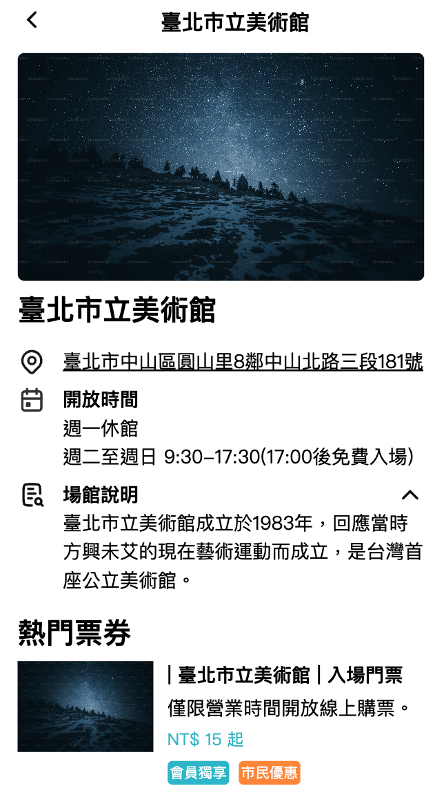
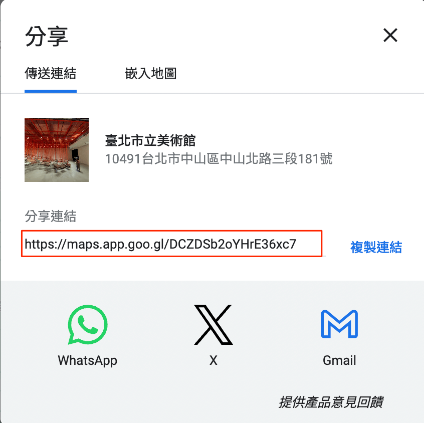

# 熱門場館

## /coupon/list?hotSpot=Y

熱門場館列表顯示所有場館，不論現在是否有入場券可購買，都會在列表中顯示。


## /coupon/hotspot/:id

熱門場館詳細頁，針對該場館的詳細介紹，若該場館有入場券可以購買，會額外提供購買頁面連結，讓使用者快速前往。



### 熱門場館-hot_spot_list

透過 `hot_spot_list` 將所有熱門場館定義在此 list 中，其中包含場館的詳細資料，會在場館詳細頁面使用，完整範例如下

json

```
{
  "data": {
    "hot_spot_list": [
      {
        "id": "t-1",
        "name": "臺北市立美術館",
        "introduce": "臺北市立美術館成立於1983年，回應當時方興未艾的現在藝術運動而成立，是臺灣首座公立美術館。",
        "business_hours": ["週一休館", "週二至週日 9:30-17:30(17:00後免費入場)"],
        "address": {
          "text": "臺北市中山區圓山里8鄰中山北路三段181號",
          "map": "https://maps.app.goo.gl/sQKx4n3WctXuS5Bw8"
        },
        "is_sell_ticket": true,
        "img_url": "https://plus.unsplash.com/premium_photo-1686741733157-1d7863a7a04e?q=80&w=2070&auto=format&fit=crop&ixlib=rb-4.0.3&ixid=M3wxMjA3fDB8MHxwaG90by1wYWdlfHx8fGVufDB8fHx8fA%3D%3D"
      },
      {
        "id": "h-1",
        "name": "臺北自來水園區",
        "introduce": "位於新店溪與思源街旁的臺北自來水發源地--臺北水源地唧筒室，其主體建築於1908年，迄今已有近百年歷史。",
        "business_hours": ["週二至週日(非夏季)9:00-17:00、夏季延長至18:00"],
        "address": {
          "text": "臺北市中正區水源里1鄰思源街1號",
          "map": "https://maps.app.goo.gl/JDU38VKe8J7BUzws7"
        },
        "is_sell_ticket": false,
        "img_url": "https://images.unsplash.com/photo-1514907707149-eca420f5de51?q=80&w=2069&auto=format&fit=crop&ixlib=rb-4.0.3&ixid=M3wxMjA3fDB8MHxwaG90by1wYWdlfHx8fGVufDB8fHx8fA%3D%3D"
      },
      {
        "id": "t-2",
        "name": "臺北市立動物園",
        "introduce": "位於捷運文湖線終點的臺北市立動物園，是一處結合自然保育、研究、教育與遊憩功能的社教機構，並於2012年4月取得環境教育設施及場所認證。",
        "business_hours": ["售票時間：上午9點至下午4點。", "使用時間：購票當日上午9點至下午4點。"],
        "address": {
          "text": "臺北市文山區萬興里31鄰新光路二段30號",
          "map": "https://maps.app.goo.gl/ePr8n9JM5X4JFSvV8"
        },
        "is_sell_ticket": true,
        "img_url": "https://images.unsplash.com/photo-1534567153574-2b12153a87f0?q=80&w=2070&auto=format&fit=crop&ixlib=rb-4.0.3&ixid=M3wxMjA3fDB8MHxwaG90by1wYWdlfHx8fGVufDB8fHx8fA%3D%3DD"
      }
    ],
  }
}
```

| 欄位 | 用途 | 範例 |
| --- | --- | --- |
| id | 場館 id，這邊要對應 [ticket_list](main-page.md#入場券-json-資料-ticket-list) 的 id 定義 | t-1 |
| name | 場館名稱 | 臺北市立美術館 |
| introduce | 場館介紹 | 臺北市立美術館成立於1983年，回應當時方興未艾的現在藝術運動而成立，是臺灣首座公立美術館。 |
| business_hours | 場館開放時間，透過陣列結構達到分段效果，ex: ["第一段", "第二段"] | ["週一休館", "週二至週日 9:30-17:30(17:00後免費入場)"] |
| address | 場館地址 | 參考[熱門場館-address](hot-spot.md#熱門場館-address) |
| is_sell_ticket | 是否有入場券可購買 | true |
| img_url | 場館圖片 | 圖片 url |

#### 熱門場館-address

| 欄位 | 用途 | 範例 |
| --- | --- | --- |
| text | 地址文字 | 臺北市中山區圓山里8鄰中山北路三段181號 |
| map | 地址 google map 連結 | [https://maps.app.goo.gl/sQKx4n3WctXuS5Bw8](https://maps.app.goo.gl/sQKx4n3WctXuS5Bw8) |

google map 連結可以透過分享功能找到


