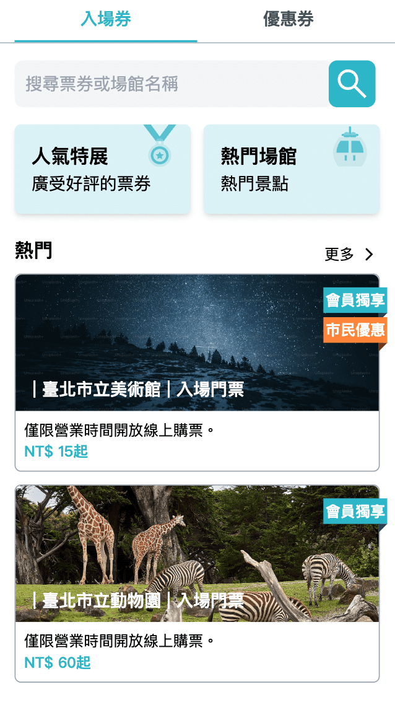

# 主頁

## /coupon

主頁面共有兩個 Tab 分別為**入場券**與**優惠券**

兩個 Tab 畫面主要都是顯示該票券的熱門項目，讓使用者可以直接點擊進入使用或是購買環節。

另外，可以透過點擊篩選與搜尋進入搜尋頁針對該類票券做搜尋。

主頁面資料都可以透過修改 JSON response 呈現開發者預期的資料。

### 入場券

入場券額外擁有兩個按鈕：

- 人氣特展，可以直接進入入場券列表讓使用者挑選。
- 熱門場館，則是介紹各場館、營業時間、地址，若該場館有票券可購買，會額外附上按鈕連結。



#### 入場券-ticket_list

透過 `ticket_list` 將所有入場券定義在此 list 中，其中包含票券的詳細資料，會在票券詳細頁面使用。

這邊會主要介紹列表需要使用到的欄位，詳細頁面相關欄位在該頁文件會有更詳細介紹，完整範例如下

json

```
{
  "data": {
    "ticket_list": [
      {
        "id": "t-1",
        "name": "臺北市立美術館",
        "type": "入場門票",
        "text": "僅限營業時間開放線上購票。",
        "price": 15,
        "vip_text": "會員獨享",
        "discount_text": "市民優惠",
        "is_hot": true,
        "img_url": "https://plus.unsplash.com/premium_photo-1686741733157-1d7863a7a04e?q=80&w=2070&auto=format&fit=crop&ixlib=rb-4.0.3&ixid=M3wxMjA3fDB8MHxwaG90by1wYWdlfHx8fGVufDB8fHx8fA%3D%3D",
        "detail_price": ["普通票(當日票):NT$30 / 人", "團體票(當日票):NT$21 / 人起(須滿 20 人)"],
        "address": {
          "text": "臺北市中山區圓山里8鄰中山北路三段181號",
          "map": "https://maps.app.goo.gl/sQKx4n3WctXuS5Bw8"
        },
        "activity_date": "2024/01/01~2024/12/31",
        "ticket_illustrate": [
          "僅限開館日每日0:00-17:00開放線上購票",
          "退票說明:如購買後未使用請於當日17:30前完成退票",
          "週一休館"
        ],
        "spot_introduce": "臺北市立美術館成立於1983年，回應當時方興未艾的現在藝術運動而成立，是臺灣首座公立美術館。",
        "instructions": ["使用票券前有條件退票", "僅限購票當日使用"],
      },
      {
        "id": "t-2",
        "name": "臺北市立動物園",
        "type": "入場門票",
        "text": "僅限營業時間開放線上購票。",
        "price": 60,
        "vip_text": "會員獨享",
        "discount_text": "",
        "is_hot": true,
        "img_url": "https://images.unsplash.com/photo-1534567153574-2b12153a87f0?q=80&w=2070&auto=format&fit=crop&ixlib=rb-4.0.3&ixid=M3wxMjA3fDB8MHxwaG90by1wYWdlfHx8fGVufDB8fHx8fA%3D%3DD",
        "detail_price": [
          "普通票(限購票當日用):NT$100 / 人",
          "臺北市民票(限購票當日使用，使用前請出示證件):NT$60元/人"
        ],
        "address": {
          "text": "臺北市文山區萬興里31鄰新光路二段30號",
          "map": "https://maps.app.goo.gl/ePr8n9JM5X4JFSvV8"
        },
        "activity_date": "2024/01/01~2024/12/31",
        "ticket_illustrate": [
          "售票時間：上午9點至下午4點。",
          "使用時間：購票當日上午9點至下午4點。",
          "已核銷後，恕不退票。"
        ],
        "spot_introduce": "位於捷運文湖線終點的臺北市立動物園，是一處結合自然保育、研究、教育與遊憩功能的社教機構，並於2012年4月取得環境教育設施及場所認證。",
        "instructions": ["使用票券前有條件退票", "僅限購票當日使用"],
      },
      {
        "id": "t-3",
        "name": "兒童新樂園",
        "type": "一日樂Fun券",
        "text": "僅限營運時間開放兌換使用，票券含入園門票及不限次數搭乘編號1號至13號大型遊樂設施。",
        "price": 200,
        "vip_text": "",
        "discount_text": "市民優惠",
        "is_hot": false,
        "img_url": "https://images.unsplash.com/photo-1575783970733-1aaedde1db74?q=80&w=2076&auto=format&fit=crop&ixlib=rb-4.0.3&ixid=M3wxMjA3fDB8MHxwaG90by1wYWdlfHx8fGVufDB8fHx8fA%3D%3D",
        "detail_price": ["一日樂FUN券：NT$200 / 人"],
        "address": {
          "text": "臺北市士林區承德路五段55號",
          "map": "https://maps.app.goo.gl/89CdbVCZH6rbfDaZ6"
        },
        "activity_date": "2024/01/01~2025/12/31",
        "ticket_illustrate": [
          "僅限營運時間開放兌換使用，票券含入園門票及不限次數搭乘編號1號至13號大型遊樂設施。"
        ],
        "spot_introduce": "臺北市立兒童新樂園(以下簡稱兒童新樂園)前身為位於員山的臺北市立兒童育樂中心。",
        "instructions": ["使用票券前有條件退票", "有效期/兌換其內皆可使用"],
      }
    ],
  }
}
```

| 欄位 | 用途 | 範例 |
| --- | --- | --- |
| id | 入場券 id | t-1 |
| name | 入場券名稱 | 兒童新樂園 |
| type | 入場券類型 | 一日樂Fun券 |
| text | 入場券說明文字 | 僅限營運時間開放兌換使用，票券含入園門票及不限次數搭乘編號1號至13號大型遊樂設施。 |
| price | 入場券價格 | 200 |
| vip_text | VIP 相關優惠文字，非必填 | 會員獨享 |
| discount_text | 一般優惠文字，非必填 | 市民優惠 |
| is_hot | 是否為熱門票券 | true |
| img_url | 入場券圖片 | 圖片 url |
| detail_price | 入場券詳細票價 | 請參考[入場券詳細](ticket-detail.md) |
| address | 該場館地址 | 請參考[入場券詳細](ticket-detail.md) |
| activity_date | 入場券活動區間 | 請參考[入場券詳細](ticket-detail.md) |
| ticket_illustrate | 入場券使用說明 | 請參考[入場券詳細](ticket-detail.md) |
| spot_introduce | 場館介紹 | 請參考[入場券詳細](ticket-detail.md) |
| instructions | 入場券使用注意事項 | 請參考[入場券詳細](ticket-detail.md) |

### 優惠券


#### 優惠券-coupon_list

透過 `coupon_list` 將所有優惠券定義在此 list 中，其中包含票券的詳細資料，會在票券詳細頁面使用。

這邊會主要介紹列表需要使用到的欄位，詳細頁面相關欄位在該頁文件會有更詳細介紹，完整範例如下

json

```
{
  "data": {
    "coupon_list": [
      {
        "id": "c-1",
        "name": "郭董私房菜",
        "text": "強強聯手 - 郭董私房菜 X 國宴主廚",
        "vip_text": "",
        "discount_text": "贈粽子",
        "deadline": "2024/06/30",
        "remaining": "",
        "is_hot": true,
        "img_url": "https://plus.unsplash.com/premium_photo-1673108852141-e8c3c22a4a22?q=80&w=2070&auto=format&fit=crop&ixlib=rb-4.0.3&ixid=M3wxMjA3fDB8MHxwaG90by1wYWdlfHx8fGVufDB8fHx8fA%3D%3D",
        "activity_date": "2024/06/10~2024/08/10",
        "rule": "每會員限領1份",
        "coupon_illustrate": "住宿9折 不限平假日\n注意事項：\n每人當天限用一次",
        "store_info": {
          "img_url": "https://plus.unsplash.com/premium_photo-1661964205360-b0621b5a9366?q=80&w=2038&auto=format&fit=crop&ixlib=rb-4.0.3&ixid=M3wxMjA3fDB8MHxwaG90by1wYWdlfHx8fGVufDB8fHx8fA%3D%3D",
          "name": "沃田旅店",
          "introduce": [
            "由全臺灣302家農會與40家漁會所共同支持成立，",
            "孕育以農漁會為主題風格的旅店。\n我們願意肩負農漁會文化的創新，勾勒臺灣地區風土時尚的樣貌，\n創造一畝心靈田園與旅客共享。"
          ],
          "address": {
            "text": "台北市士林區中山北路七段127號",
            "map": "https://maps.app.goo.gl/jN5AyYmkmDsmYX547"
          }
        }
      },
      {
        "id": "c-2",
        "name": "阿爸手工皂",
        "text": "滿1000元送100元。",
        "vip_text": "",
        "discount_text": "滿千送百",
        "deadline": "2024/06/30",
        "remaining": "158",
        "is_hot": true,
        "img_url": "https://images.unsplash.com/photo-1454873019514-eae2f086587a?q=80&w=2073&auto=format&fit=crop&ixlib=rb-4.0.3&ixid=M3wxMjA3fDB8MHxwaG90by1wYWdlfHx8fGVufDB8fHx8fA%3D%3D",
        "activity_date": "2024/06/10~2024/08/10",
        "rule": "",
        "coupon_illustrate": "住宿9折 不限平假日\n注意事項：\n每人當天限用一次",
        "store_info": {
          "img_url": "https://plus.unsplash.com/premium_photo-1661964205360-b0621b5a9366?q=80&w=2038&auto=format&fit=crop&ixlib=rb-4.0.3&ixid=M3wxMjA3fDB8MHxwaG90by1wYWdlfHx8fGVufDB8fHx8fA%3D%3D",
          "name": "阿爸手工皂",
          "introduce": [
            "由全臺灣302家農會與40家漁會所共同支持成立，",
            "孕育以農漁會為主題風格的旅店。\n我們願意肩負農漁會文化的創新，勾勒臺灣地區風土時尚的樣貌，\n創造一畝心靈田園與旅客共享。"
          ],
          "address": {
            "text": "台北市士林區中山北路七段127號",
            "map": "https://maps.app.goo.gl/jN5AyYmkmDsmYX547"
          }
        }
      },
      {
        "id": "c-3",
        "name": "沃田旅店",
        "text": "餐飲消費滿1500送薑爆小卷(小份)、消費滿5000送薑爆小卷(大份)\n注意事項：適用於小吃單點、桌菜(合菜不適用)",
        "vip_text": "",
        "discount_text": "",
        "deadline": "2024/12/31",
        "remaining": "",
        "is_hot": true,
        "img_url": "https://images.unsplash.com/photo-1520250497591-112f2f40a3f4?q=80&w=2070&auto=format&fit=crop&ixlib=rb-4.0.3&ixid=M3wxMjA3fDB8MHxwaG90by1wYWdlfHx8fGVufDB8fHx8fA%3D%3D",
        "activity_date": "2024/06/10~2024/08/10",
        "rule": "每會員限領1份",
        "coupon_illustrate": "住宿9折 不限平假日\n注意事項：\n每人當天限用一次",
        "store_info": {
          "img_url": "https://plus.unsplash.com/premium_photo-1661964205360-b0621b5a9366?q=80&w=2038&auto=format&fit=crop&ixlib=rb-4.0.3&ixid=M3wxMjA3fDB8MHxwaG90by1wYWdlfHx8fGVufDB8fHx8fA%3D%3D",
          "name": "沃田旅店",
          "introduce": [
            "由全臺灣302家農會與40家漁會所共同支持成立，",
            "孕育以農漁會為主題風格的旅店。\n我們願意肩負農漁會文化的創新，勾勒臺灣地區風土時尚的樣貌，\n創造一畝心靈田園與旅客共享。"
          ],
          "address": {
            "text": "台北市士林區中山北路七段127號",
            "map": "https://maps.app.goo.gl/jN5AyYmkmDsmYX547"
          }
        }
      }
    ]
  }
}
```

| 欄位 | 用途 | 範例 |
| --- | --- | --- |
| id | 優惠券 id | c-1 |
| name | 優惠券名稱 | 郭董私房菜 |
| text | 優惠券說明文字 | 強強聯手 - 郭董私房菜 X 國宴主廚 |
| vip_text | VIP 相關優惠文字，非必填 | 會員獨享 |
| discount_text | 一般優惠文字，非必填 | 市民優惠 |
| deadline | 優惠券期限 | 2024/12/31 |
| remaining | 優惠券剩餘份數，非必填 | 158 |
| is_hot | 是否為熱門票券 | true |
| img_url | 優惠券圖片 | 圖片 url |
| activity_date | 優惠券活動區間 | 請參考[優惠券詳細](coupon-detail.md) |
| rule | 優惠券使用規則 | 請參考[優惠券詳細](coupon-detail.md) |
| coupon_illustrate | 優惠券使用說明 | 請參考[優惠券詳細](coupon-detail.md) |
| store_info | 優惠券店家資訊 | 請參考[優惠券詳細](coupon-detail.md) |
