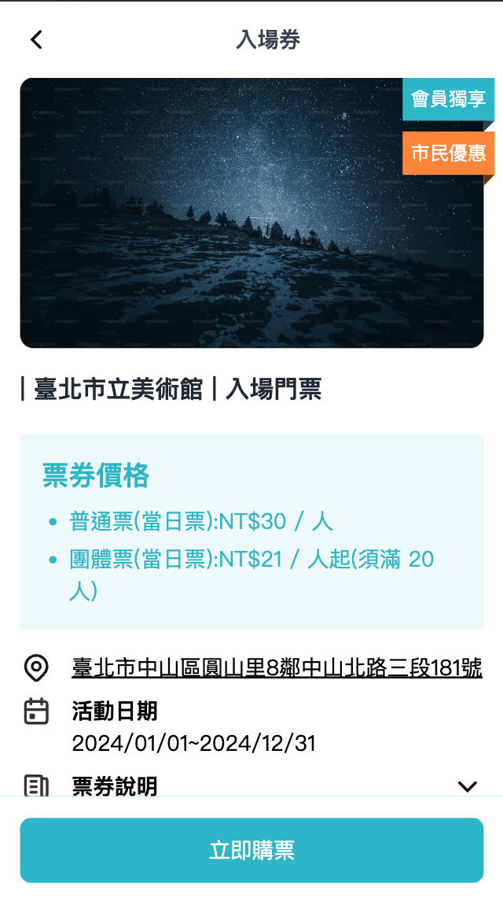
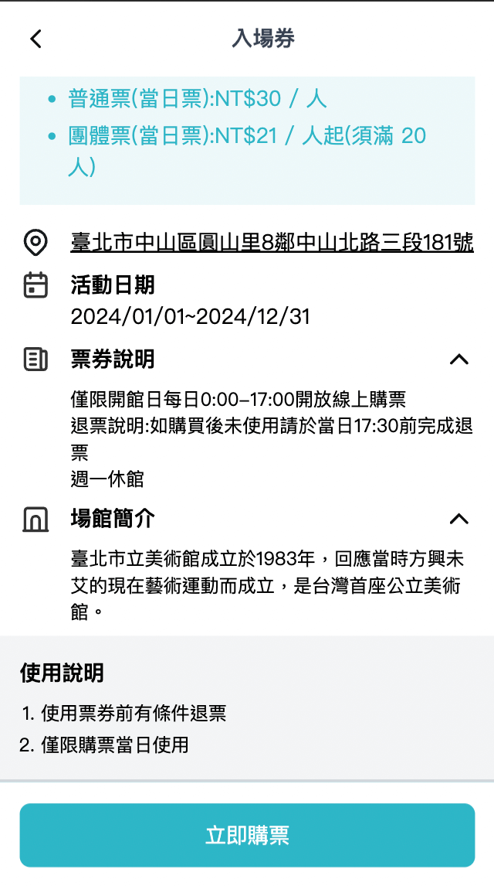
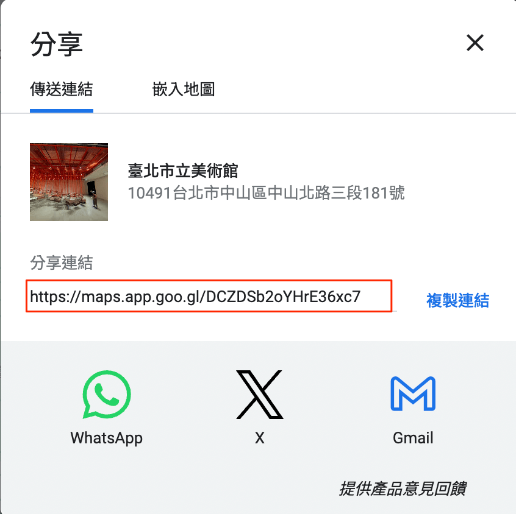

# 入場券詳細

## /coupon/ticket-detail/:id

入場券詳細中包含更詳細的價格說明、場館說明、購買連結等。





### 入場券-ticket_list

詳細的資料皆在主頁提到 `ticket_list` 中定義。

這邊會主要介紹詳細頁面使用的欄位，列表相關欄位在主頁有更詳細介紹，完整範例如下

json

```
{
  "data": {
    "ticket_list": [
      {
        "id": "t-1",
        "name": "臺北市立美術館",
        "type": "入場門票",
        "text": "僅限營業時間開放線上購票。",
        "price": 15,
        "vip_text": "會員獨享",
        "discount_text": "市民優惠",
        "is_hot": true,
        "img_url": "https://plus.unsplash.com/premium_photo-1686741733157-1d7863a7a04e?q=80&w=2070&auto=format&fit=crop&ixlib=rb-4.0.3&ixid=M3wxMjA3fDB8MHxwaG90by1wYWdlfHx8fGVufDB8fHx8fA%3D%3D",
        "detail_price": ["普通票(當日票):NT$30 / 人", "團體票(當日票):NT$21 / 人起(須滿 20 人)"],
        "address": {
          "text": "臺北市中山區圓山里8鄰中山北路三段181號",
          "map": "https://maps.app.goo.gl/sQKx4n3WctXuS5Bw8"
        },
        "activity_date": "2024/01/01~2024/12/31",
        "ticket_illustrate": [
          "僅限開館日每日0:00-17:00開放線上購票",
          "退票說明:如購買後未使用請於當日17:30前完成退票",
          "週一休館"
        ],
        "spot_introduce": "臺北市立美術館成立於1983年，回應當時方興未艾的現在藝術運動而成立，是臺灣首座公立美術館。",
        "instructions": ["使用票券前有條件退票", "僅限購票當日使用"],
      },
      {
        "id": "t-2",
        "name": "臺北市立動物園",
        "type": "入場門票",
        "text": "僅限營業時間開放線上購票。",
        "price": 60,
        "vip_text": "會員獨享",
        "discount_text": "",
        "is_hot": true,
        "img_url": "https://images.unsplash.com/photo-1534567153574-2b12153a87f0?q=80&w=2070&auto=format&fit=crop&ixlib=rb-4.0.3&ixid=M3wxMjA3fDB8MHxwaG90by1wYWdlfHx8fGVufDB8fHx8fA%3D%3DD",
        "detail_price": [
          "普通票(限購票當日用):NT$100 / 人",
          "臺北市民票(限購票當日使用，使用前請出示證件):NT$60元/人"
        ],
        "address": {
          "text": "臺北市文山區萬興里31鄰新光路二段30號",
          "map": "https://maps.app.goo.gl/ePr8n9JM5X4JFSvV8"
        },
        "activity_date": "2024/01/01~2024/12/31",
        "ticket_illustrate": [
          "售票時間：上午9點至下午4點。",
          "使用時間：購票當日上午9點至下午4點。",
          "已核銷後，恕不退票。"
        ],
        "spot_introduce": "位於捷運文湖線終點的臺北市立動物園，是一處結合自然保育、研究、教育與遊憩功能的社教機構，並於2012年4月取得環境教育設施及場所認證。",
        "instructions": ["使用票券前有條件退票", "僅限購票當日使用"],
      },
      {
        "id": "t-3",
        "name": "兒童新樂園",
        "type": "一日樂Fun券",
        "text": "僅限營運時間開放兌換使用，票券含入園門票及不限次數搭乘編號1號至13號大型遊樂設施。",
        "price": 200,
        "vip_text": "",
        "discount_text": "市民優惠",
        "is_hot": false,
        "img_url": "https://images.unsplash.com/photo-1575783970733-1aaedde1db74?q=80&w=2076&auto=format&fit=crop&ixlib=rb-4.0.3&ixid=M3wxMjA3fDB8MHxwaG90by1wYWdlfHx8fGVufDB8fHx8fA%3D%3D",
        "detail_price": ["一日樂FUN券：NT$200 / 人"],
        "address": {
          "text": "臺北市士林區承德路五段55號",
          "map": "https://maps.app.goo.gl/89CdbVCZH6rbfDaZ6"
        },
        "activity_date": "2024/01/01~2025/12/31",
        "ticket_illustrate": [
          "僅限營運時間開放兌換使用，票券含入園門票及不限次數搭乘編號1號至13號大型遊樂設施。"
        ],
        "spot_introduce": "臺北市立兒童新樂園(以下簡稱兒童新樂園)前身為位於員山的臺北市立兒童育樂中心。",
        "instructions": ["使用票券前有條件退票", "有效期/兌換其內皆可使用"],
      }
    ],
  }
}
```

| 欄位 | 用途 | 範例 |
| --- | --- | --- |
| id | 入場券 id | t-1 |
| name | 入場券名稱 | 兒童新樂園 |
| type | 入場券類型 | 一日樂Fun券 |
| text | 入場券說明文字 | 請參考[主頁](main-page.md#入場券-ticket-list) |
| price | 入場券價格 | 請參考[主頁](main-page.md#入場券-ticket-list) |
| vip_text | VIP 相關優惠文字，非必填 | 會員獨享 |
| discount_text | 一般優惠文字，非必填 | 市民優惠 |
| is_hot | 是否為熱門票券 | 請參考[主頁](main-page.md#入場券-ticket-list) |
| img_url | 入場券圖片 | 圖片 url |
| detail_price | 入場券詳細票價，透過陣列結構達到分段效果，ex: ["第一段", "第二段"] | ["普通票(當日票):NT$30 / 人", "團體票(當日票):NT$21 / 人起(須滿 20 人)"] |
| address | 場館地址 | 參考[入場券-address](ticket-detail.md#入場券-address) |
| activity_date | 入場券活動區間 | 2024/01/01~2024/12/31 |
| ticket_illustrate | 入場券使用說明，透過陣列結構達到分段效果，ex: ["第一段", "第二段"] | ["僅限營運時間開放兌換使用，票券含入園門票及不限次數搭乘編號1號至13號大型遊樂設施。"] |
| spot_introduce | 場館介紹 | 臺北市立美術館成立於1983年，回應當時方興未艾的現在藝術運動而成立，是臺灣首座公立美術館。 |
| instructions | 入場券使用注意事項，透過陣列結構達到分段效果，ex: ["第一段", "第二段"] | ["使用票券前有條件退票", "僅限購票當日使用"] |

#### 入場券-address

| 欄位 | 用途 | 範例 |
| --- | --- | --- |
| text | 地址文字 | 臺北市中山區圓山里8鄰中山北路三段181號 |
| map | 地址 google map 連結 | [https://maps.app.goo.gl/sQKx4n3WctXuS5Bw8](https://maps.app.goo.gl/sQKx4n3WctXuS5Bw8) |

google map 連結可以透過分享功能找到


