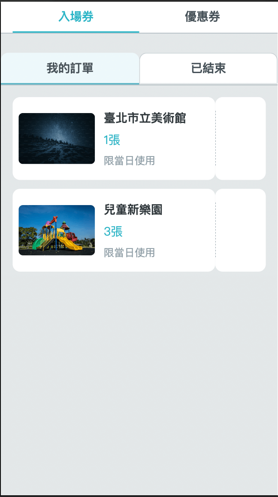
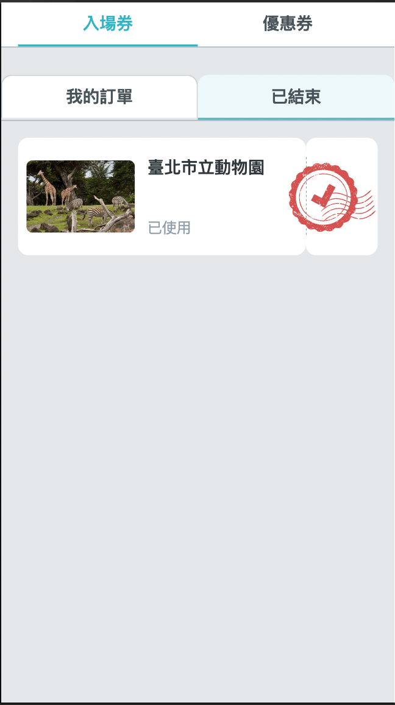
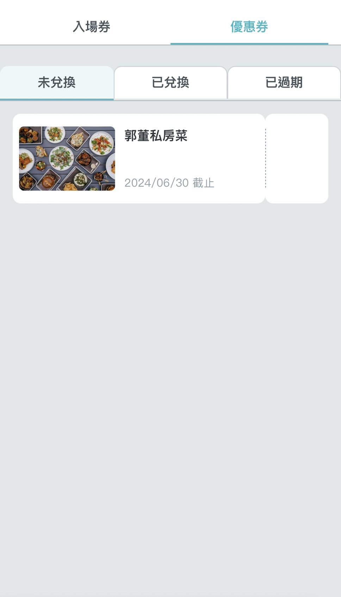

# 票夾

## /ticket-wallet

票夾顯示各種類已擁有票券，可在此操作票券使用。

### 入場券

入場券分為兩大項：我的訂單、已結束

- 我的訂單，顯示尚未使用且尚未過期的入場券，點擊後會產生 Qrcode 供各場館入場時掃描使用。




- 已結束，凡是已使用或是已過期入場券皆會顯示於此分類。



### 優惠券

優惠券分為三大項：未兌換、已兌換、已過期

- 未兌換，顯示尚未兌換的優惠券，點擊後會導頁前往兌換頁，方便店家兌換。



- 已兌換，顯示已兌換的優惠券，並顯示兌換時間。


- 已過期，顯示已過期的優惠券，並顯示過期時間。


### 票夾資料

票夾資料定義如下，包含了入場券(admission)與優惠券(coupon)的資料。

json

```
{
  "data": {
    "admission": {
      "my_order": [
        {
          "id": "t-1",
          "name": "臺北市立美術館",
          "img_url": "https://plus.unsplash.com/premium_photo-1686741733157-1d7863a7a04e?q=80&w=2070&auto=format&fit=crop&ixlib=rb-4.0.3&ixid=M3wxMjA3fDB8MHxwaG90by1wYWdlfHx8fGVufDB8fHx8fA%3D%3D",
          "date": "限當日使用",
          "total": "1",
          "qrcode": "https://www.gov.taipei/"
        },
        {
          "id": "t-3",
          "name": "兒童新樂園",
          "img_url": "https://images.unsplash.com/photo-1575783970733-1aaedde1db74?q=80&w=2076&auto=format&fit=crop&ixlib=rb-4.0.3&ixid=M3wxMjA3fDB8MHxwaG90by1wYWdlfHx8fGVufDB8fHx8fA%3D%3D",
          "date": "限當日使用",
          "total": "3",
          "qrcode": "https://tailwindcss.com/"
        }
      ],
      "finished": [
        {
          "id": "t-2",
          "name": "臺北市立動物園",
          "img_url": "https://images.unsplash.com/photo-1534567153574-2b12153a87f0?q=80&w=2070&auto=format&fit=crop&ixlib=rb-4.0.3&ixid=M3wxMjA3fDB8MHxwaG90by1wYWdlfHx8fGVufDB8fHx8fA%3D%3DD",
          "date": "已使用",
          "total": "",
          "qrcode": ""
        }
      ]
    },
    "coupon": {
      "not_redeemed": [
        {
          "id": "c-1",
          "name": "郭董私房菜",
          "img_url": "https://plus.unsplash.com/premium_photo-1673108852141-e8c3c22a4a22?q=80&w=2070&auto=format&fit=crop&ixlib=rb-4.0.3&ixid=M3wxMjA3fDB8MHxwaG90by1wYWdlfHx8fGVufDB8fHx8fA%3D%3D",
          "total": "",
          "date": "2024/06/30"
        }
      ],
      "redeemed": [
        {
          "id": "c-2",
          "name": "阿爸手工皂",
          "img_url": "https://images.unsplash.com/photo-1454873019514-eae2f086587a?q=80&w=2073&auto=format&fit=crop&ixlib=rb-4.0.3&ixid=M3wxMjA3fDB8MHxwaG90by1wYWdlfHx8fGVufDB8fHx8fA%3D%3D",
          "total": "",
          "date": "2024/09/01 14:00"
        }
      ],
      "expired": [
        {
          "id": "c-3",
          "name": "沃田旅店",
          "img_url": "https://images.unsplash.com/photo-1520250497591-112f2f40a3f4?q=80&w=2070&auto=format&fit=crop&ixlib=rb-4.0.3&ixid=M3wxMjA3fDB8MHxwaG90by1wYWdlfHx8fGVufDB8fHx8fA%3D%3D",
          "total": "",
          "date": "2024/06/30"
        }
      ]
    }
  }
}
```

| 欄位 | 用途 | 範例 |
| --- | --- | --- |
| admission | 入場券資料 | 參考[入場券-detail](ticket-wallet.md#入場券-detail) |
| coupon | 優惠券資料 | 參考[優惠券-detail](ticket-wallet.md#優惠券-detail) |

#### 入場券-detail

| 欄位 | 用途 | 範例 |
| --- | --- | --- |
| my_order | 我的訂單 | 參考[入場券-my_order](ticket-wallet.md#入場券-my_order) |
| finished | 已結束 | 參考[入場券-finished](ticket-wallet.md#入場券-finished) |

#### 入場券-my_order

| 欄位 | 用途 | 範例 |
| --- | --- | --- |
| id | 入場券ID | t-1 |
| name | 入場券名稱 | 臺北市立美術館 |
| img_url | 入場券圖片 | 圖片 url |
| date | 入場券使用期限 | 限當日使用、20XX-XX-XX、已使用 |
| total | 票數 | 5 |
| qrcode | 入場券 Qrcode 路徑 | Qrcode 掃描對應的 url，ex: [https://www.gov.taipei/](https://www.gov.taipei/) |

#### 入場券-finished

欄位格式同 [入場券-my_order](ticket-wallet.md#入場券-my_order)，`qrcode` 欄位不用填。

#### 優惠券-detail

| 欄位 | 用途 | 範例 |
| --- | --- | --- |
| not_redeemed | 未兌換 | 參考[優惠券-not_redeemed](ticket-wallet.md#優惠券-not_redeemed) |
| redeemed | 已兌換 | 參考[優惠券-redeemed](ticket-wallet.md#優惠券-redeemed) |
| expired | 已過期 | 參考[優惠券-expired](ticket-wallet.md#優惠券-expired) |

#### 優惠券-not_redeemed

| 欄位 | 用途 | 範例 |
| --- | --- | --- |
| id | 優惠券ID | c-1 |
| name | 優惠券名稱 | 郭董私房菜 |
| img_url | 優惠券圖片 | 圖片 url |
| total | 票數 | 5 |
| date | 優惠券使用期限 | 2024/06/30、2024/06/30 14:00 |

#### 優惠券-redeemed

欄位格式同 [優惠券-not_redeemed](ticket-wallet.md#優惠券-not_redeemed)，`date` 欄位填入兌換的時間。

#### 優惠券-expired

欄位格式同 [優惠券-not_redeemed](ticket-wallet.md#優惠券-not_redeemed)。
